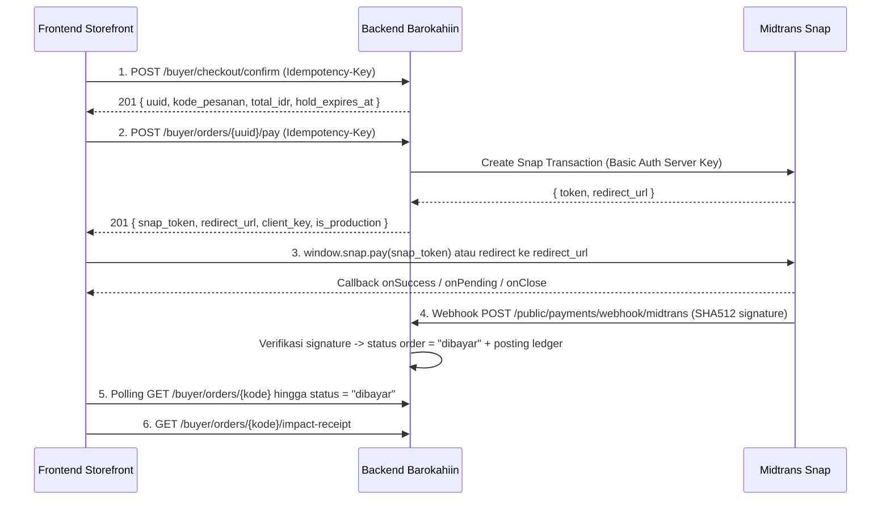

# Panduan Integrasi Payment Gateway Midtrans (Frontend Storefront Barokahiin)

Dokumen ini adalah **panduan khusus tim Frontend Storefront** untuk mengintegrasikan pembayaran **Midtrans Snap** pada Barokahiin secara aman dan sesuai arsitektur e-commerce.

> **Aturan Keamanan Utama:**
> - **Jangan pernah** menaruh `MIDTRANS_SERVER_KEY` di kode frontend. Frontend hanya menggunakan **`client_key`** dan **`snap_token`** yang diberikan backend.
> - **Jangan pernah** menganggap callback `onSuccess` dari Midtrans Snap.js sebagai bukti lunas final — status resmi pesanan **selalu** diverifikasi dari backend (`GET /barokahiin/buyer/orders/{kode}`) setelah webhook Midtrans diterima backend.

---

## 1. Alur Pembayaran (Sequence)



---

## 2. Langkah Integrasi di Frontend

### Langkah 1 — Buat Transaksi Pembayaran ke Backend
Setelah `POST /api/v1/barokahiin/buyer/checkout/confirm` berhasil (`201`), panggil:

- **Endpoint**: `POST /api/v1/barokahiin/buyer/orders/{order_uuid}/pay`
- **Headers**:
  - `Authorization: Bearer <buyer_token>`
  - `Idempotency-Key: <uuid-unik>` *(wajib agar klik ganda tidak membuat transaksi Midtrans duplikat)*
- **Body**:
  ```json
  {
    "metode": "snap"
  }
  ```
  *Opsi `metode` yang didukung:*
  - `"snap"` *(disarankan — menampilkan semua metode aktif: QRIS, GoPay, ShopeePay, BCA/BNI/BRI/Mandiri/Permata VA)*
  - `"qris"` *(hanya QRIS & GoPay)*
  - `"va"` *(Virtual Account; boleh tambah `"bank": "bca" | "bni" | "bri" | "permata" | "mandiri"`)*
  - `"ewallet"` *(GoPay & ShopeePay)*

- **Contoh Respons `201 Created`**:
  ```json
  {
    "success": true,
    "message": "Instruksi pembayaran Midtrans dibuat.",
    "data": {
      "uuid": "8c54c08f-...",
      "gateway": "midtrans",
      "gateway_ref": "ORD-20261125-ABC123-XY9Z",
      "snap_token": "66e4fa55-fdac-4ef9-91b5-733b97d1b862",
      "redirect_url": "https://app.sandbox.midtrans.com/snap/v4/redirection/66e4fa55-...",
      "metode": "snap",
      "jumlah_idr": 225000,
      "status": "pending",
      "kedaluwarsa_pada": "2026-11-25T08:30:00.000000Z",
      "client_key": "SB-Mid-client-xxxx",
      "is_production": false,
      "is_mock": false,
      "payment_instructions": {
        "enabled_payments": ["other_qris", "gopay", "shopeepay", "bca_va", "bni_va", "bri_va", "permata_va", "echannel"],
        "snap_js_url": "https://app.sandbox.midtrans.com/snap/snap.js"
      }
    }
  }
  ```

---

### Langkah 2 — Muat `snap.js` Dinamis & Panggil `window.snap.pay()`

Gunakan helper berikut (React / Vue / Next.js) agar URL `snap.js` otomatis mengikuti mode **Sandbox** atau **Production** dari backend:

```js
export function loadMidtransSnap(snapJsUrl, clientKey) {
  return new Promise((resolve, reject) => {
    if (window.snap) return resolve(window.snap);

    const existing = document.querySelector('script[data-midtrans-snap="true"]');
    if (existing) {
      existing.addEventListener("load", () => resolve(window.snap));
      return;
    }

    const script = document.createElement("script");
    script.src = snapJsUrl;
    script.setAttribute("data-client-key", clientKey || "");
    script.setAttribute("data-midtrans-snap", "true");
    script.onload = () => resolve(window.snap);
    script.onerror = () => reject(new Error("Gagal memuat Midtrans Snap.js"));
    document.body.appendChild(script);
  });
}

export async function payWithMidtrans(paymentData, { onSettled, onPending, onClosed }) {
  // Fallback ke redirect_url jika mode mock atau script diblokir browser
  const snapJsUrl = paymentData.payment_instructions?.snap_js_url;
  if (paymentData.is_mock || !snapJsUrl || !paymentData.client_key) {
    window.location.href = paymentData.redirect_url;
    return;
  }

  const snap = await loadMidtransSnap(snapJsUrl, paymentData.client_key);

  snap.pay(paymentData.snap_token, {
    onSuccess: () => onSettled?.(),
    onPending: () => onPending?.(),
    onError: () => onPending?.(),
    onClose: () => onClosed?.(),
  });
}
```

---

### Langkah 3 — Polling Status Pesanan (Verifikasi Backend)

Setelah `onSuccess` atau `onPending` terpanggil (atau saat user kembali dari `redirect_url`), lakukan polling ke backend setiap 3 detik (maksimal ~30–60 detik):

```js
export async function pollOrderUntilPaid(api, token, orderKode, maxAttempts = 15) {
  for (let i = 0; i < maxAttempts; i++) {
    const res = await api.get(`/barokahiin/buyer/orders/${orderKode}`, {
      headers: { Authorization: `Bearer ${token}` },
    });
    const status = res.data?.data?.status;

    if (status === "dibayar") return { status: "dibayar", order: res.data.data };
    if (status === "kedaluwarsa" || status === "dibatalkan") return { status, order: res.data.data };

    await new Promise((r) => setTimeout(r, 3000));
  }
  return { status: "menunggu_bayar" };
}
```

Begitu `status === "dibayar"`:
1. Tampilkan halaman sukses pembayaran.
2. Panggil `GET /api/v1/barokahiin/buyer/orders/{orderKode}/impact-receipt` untuk menampilkan **Kuitansi Kebaikan**.
3. Jika metode serah adalah `ambil`, panggil `GET /api/v1/barokahiin/buyer/orders/{orderKode}/pickup` untuk menampilkan alamat lengkap titik ambil.

---

## 3. Penanganan Edge Case Penting

| Kondisi | Yang Harus Dilakukan Frontend |
|---|---|
| **User menutup popup Snap (`onClose`)** | Jangan batalkan pesanan. Tampilkan tombol **"Lanjutkan Pembayaran"** yang membuka ulang `window.snap.pay(snap_token)` menggunakan `snap_token` yang sudah tersimpan di `order.payments[0].snap_token` (selama `hold_expires_at` belum lewat). |
| **Countdown Hold 30 Menit Habis** | Disable tombol bayar dan refresh `GET /buyer/orders/{kode}`. Jika status menjadi `kedaluwarsa`, tampilkan pesan bahwa waktu bayar habis dan barang kembali tersedia di katalog. |
| **Error `409 INVALID_ORDER_STATUS`** | Pesanan sudah dibayar atau kedaluwarsa — refresh detail pesanan dan arahkan ke tampilan status terbaru. |
| **Error `502 PAYMENT_GATEWAY_ERROR`** | Tampilkan pesan ramah ("Layanan pembayaran sedang sibuk, silakan coba beberapa saat lagi") dengan tombol coba lagi memakai `Idempotency-Key` baru. |
| **Webhook Midtrans** | **Sepenuhnya ditangani backend** di `POST /api/v1/barokahiin/public/payments/webhook/midtrans`. Frontend **tidak perlu dan tidak boleh** memanggil endpoint webhook ini. |
