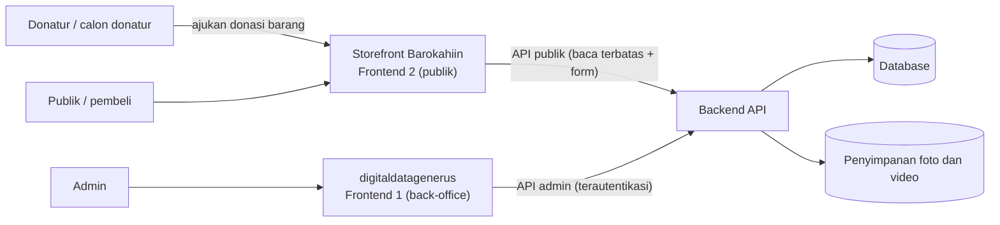
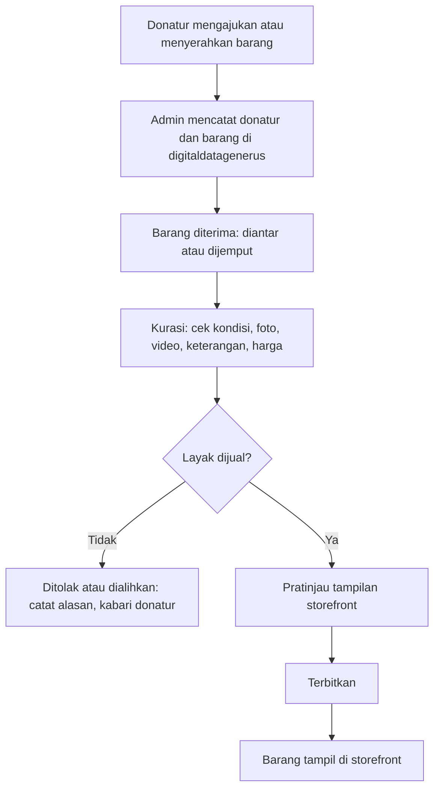
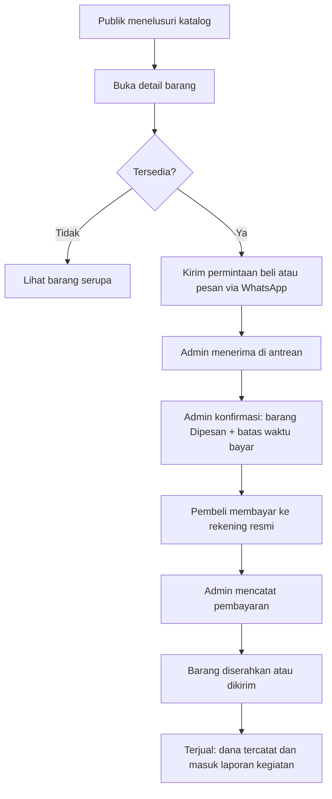
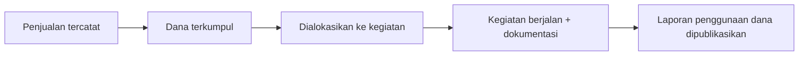
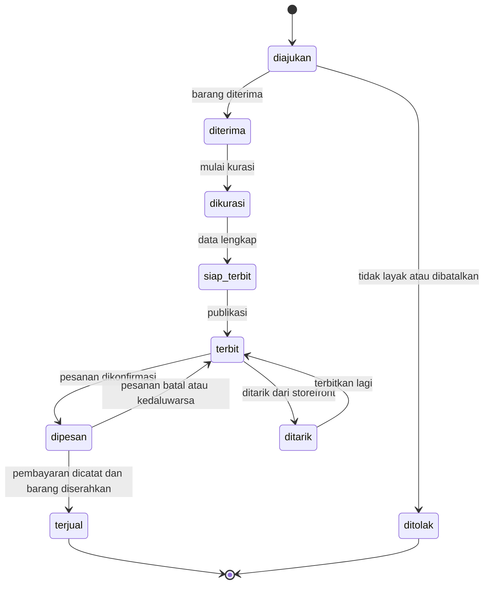
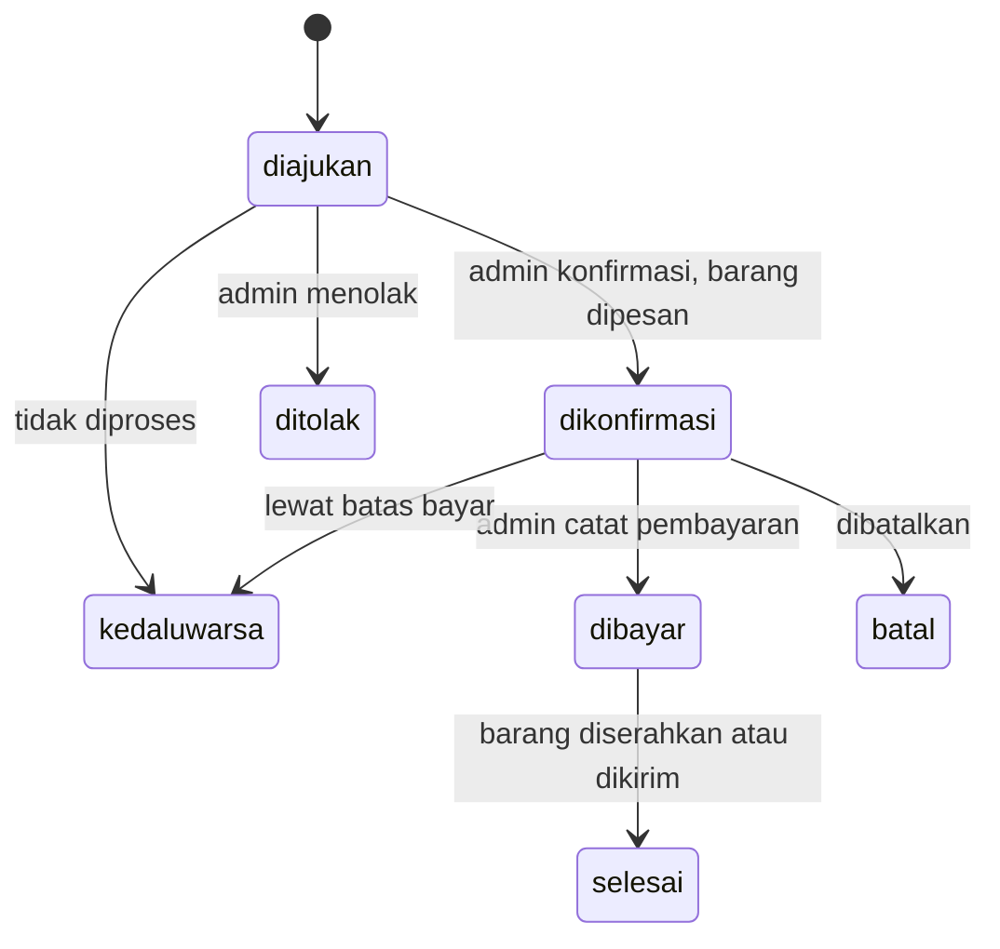

# PRD: Barokahiin

| | |
|---|---|
| **Versi** | 0.3 (perubahan arah produk; draf untuk review tim UI/UX, Frontend, Backend) |
| **Tanggal** | 17 November 2026 |
| **Pemilik produk** | _(isi nama)_ |
| **Status** | Draf. Beberapa keputusan menunggu jawaban (lihat [Bagian 18](#18-keputusan-dan-pertanyaan-terbuka)) |
| **Pembaca** | UI/UX (utama), Frontend (2 aplikasi), Backend, QA |

> **Catatan jujur tentang isi dokumen ini.** Semua yang berlabel **[Asumsi]** atau **[Usulan]** belum divalidasi. Dokumen ini **tidak memuat data pasar atau statistik** karena belum ada sumbernya. Angka target ditulis _TBD_ sampai ada data dasar. Saya **tidak punya informasi apa pun tentang sistem `digitaldatagenerus`** (teknologi, API, apakah sudah berjalan) selain yang disebut pemilik produk, jadi bagian terkait dibuat netral dan ditandai untuk dikonfirmasi.

### Riwayat revisi
| Versi | Perubahan |
|---|---|
| 0.1 | Berbagi barang gratis antarpengguna |
| 0.2 | Gratis dan berbayar antarpengguna, Jalur Segera, PWA, fokus Bandung |
| **0.3** | **Arah berubah:** barang dari pengguna **dikumpulkan datanya**, **dikurasi admin**, **ditampilkan di website untuk dijual**, dan **hasilnya untuk pendanaan kegiatan**. Ada **dua frontend**: `digitaldatagenerus` (kelola data user dan barang) dan **storefront baru** (tampilan barang jual). Model antarpengguna v0.2 diarsipkan di `arsip/prd_v0.2_berbagi-antarpengguna.md` |

---

## Cara membaca dokumen ini

| Tim | Baca terutama | Hasil yang diharapkan |
|---|---|---|
| **UI/UX** | Bagian 1–9, 11, 15 | Riset, flow, wireframe, design system untuk **dua** antarmuka |
| **Frontend 1 (digitaldatagenerus)** | Bagian 6, 9, 10.1, 12.1 | Aplikasi admin: kelola donatur, barang, media, pesanan, dana |
| **Frontend 2 (storefront)** | Bagian 6, 9, 10.2, 12.2 | Situs publik: katalog, detail, kegiatan, transparansi |
| **Backend** | Bagian 6, 9, 10, 13, 14, 15 | Model data, API publik dan admin, media, keamanan |
| **QA** | Bagian 10, 14, 15, 17 | Kriteria uji |

---

## Cara saya memahami update ini (mohon dikoreksi bila keliru)

| # | Pemahaman | Sumber |
|---|---|---|
| A1 | Pengguna (**donatur**) menyerahkan barang; **datanya dikumpulkan** pengelola. Donatur tidak menjual sendiri. | Pernyataan pemilik produk + **[Asumsi]** |
| A2 | Barang **dijual oleh pengelola** di website. **Harga ditetapkan admin.** | Pernyataan + **[Asumsi]** pada siapa menetapkan harga |
| A3 | **Hasil penjualan untuk pendanaan kegiatan.** | Pernyataan pemilik produk |
| A4 | Dua peran di sisi tampilan: **Publik** (melihat) dan **Admin** (mengunggah foto/video dan memberi keterangan). | Pernyataan pemilik produk |
| A5 | **Frontend 1 = `digitaldatagenerus`** untuk mengelola data user dan barangnya. **Frontend 2 = tampilan baru** untuk menampilkan barang yang dijual. | Pernyataan pemilik produk |
| A6 | Kedua frontend memakai **satu backend/data yang sama**. | **[Asumsi]** |
| A7 | Publik membeli lewat **permintaan beli** yang diproses admin; pembayaran dilakukan di luar aplikasi pada MVP. | **[Usulan]**, belum diputuskan (K1) |
| A8 | "Kegiatan" adalah kegiatan sosial/keagamaan yang diselenggarakan pengelola; jenisnya belum disebutkan. | **[Asumsi]** |
| A9 | Model berbagi antarpengguna v0.2 (klaim, chat, serah terima berkode, Jalur Segera) **tidak masuk MVP**. | **[Asumsi]**, mohon konfirmasi (K8) |

---

## 1. Ringkasan

**Barokahiin** mengubah barang layak dari masyarakat menjadi dana kebaikan. Alurnya:

**Donatur menyerahkan barang → admin mencatat dan mengurasi → barang tampil di website → publik membeli → hasilnya mendanai kegiatan → laporan dipublikasikan.**

**Proposisi nilai:**
- **Donatur:** barang yang tidak terpakai menjadi manfaat, tanpa repot menjual sendiri, dan identitas dapat dijaga (anonim).
- **Publik/pembeli:** barang layak dengan harga jelas, foto dan video yang jujur, dan **kejelasan ke mana uangnya pergi**.
- **Pengelola/admin:** satu tempat kerja untuk data donatur, barang, media, pesanan, dan pencatatan dana.

**Pembeda utama:** kepercayaan. Karena publik membayar untuk tujuan sosial, Barokahiin harus unggul pada **transparansi dana**, **kejujuran kondisi barang**, dan **perlindungan data donatur**.

**Tagline [Usulan]:** "Barang yang kamu beli, kebaikan yang kita danai."

---

## 2. Latar belakang dan masalah

**[Asumsi, perlu divalidasi lewat riset]**

1. Banyak orang punya barang layak yang tidak terpakai, tetapi tidak sempat atau tidak mau menjualnya sendiri.
2. Pengelola kegiatan sosial butuh sumber dana yang berkelanjutan.
3. Menjual barang donasi lewat media sosial berantakan: foto dan keterangan tidak seragam, sulit dilacak, dan pencatatan dana tidak rapi.
4. Publik ragu membeli untuk tujuan sosial bila tidak jelas siapa yang menjual, kondisi barang, dan penggunaan dananya.
5. Donatur khawatir data pribadi dan foto mereka tersebar.

**Yang perlu dibuktikan dalam riset awal:** apakah donatur mau menyerahkan barang untuk dijual, apakah publik mau membeli, dan faktor apa yang membuat mereka percaya.

---

## 3. Tujuan dan non-tujuan

### Tujuan
| # | Tujuan | Ukuran keberhasilan |
|---|---|---|
| T1 | Mengubah barang donasi menjadi dana kegiatan | Dana terkumpul per bulan (TBD) |
| T2 | Memproses barang dari diterima sampai terbit dengan cepat dan rapi | Waktu dari diterima ke terbit (TBD) |
| T3 | Menumbuhkan kepercayaan publik | Kunjungan ke halaman transparansi, konversi kunjungan ke permintaan beli (TBD) |
| T4 | Melindungi data donatur dan pembeli | Nol kebocoran data pribadi; kepatuhan pada checklist privasi |
| T5 | Admin bekerja efisien | Waktu rata-rata menyelesaikan satu barang di digitaldatagenerus (TBD) |

### Non-tujuan (tidak dikerjakan di MVP)
- **Pembayaran online di dalam website** (payment gateway/keranjang/checkout). Lihat K1.
- Transaksi antarpengguna (pengguna menjual atau memberi langsung ke pengguna lain). Diarsipkan.
- Akun login untuk publik dan donatur (lihat K2).
- Lelang dan tawar-menawar terstruktur.
- Aplikasi native.
- Bahasa daerah.

---

## 4. Pengguna dan peran

| Peran | Hak akses |
|---|---|
| **Publik** | Tanpa login. Melihat katalog, detail barang, kegiatan, dan laporan; mengirim permintaan beli; mengajukan donasi barang. |
| **Admin** | Login di **digitaldatagenerus**. Mengelola donatur, barang, foto/video, keterangan, pesanan, pencatatan dana, kegiatan, dan konten. |
| **Donatur** | **Subjek data**, bukan pengguna sistem di MVP **[Usulan]**. Dikabari admin (lihat K2). |

> **RBAC-ready:** peran disimpan sebagai data sehingga nanti bisa dipecah menjadi *Admin Konten*, *Admin Keuangan*, dan *Super Admin* tanpa merombak sistem. MVP memakai **satu peran Admin** sesuai arahan (K9).

### Persona awal **[Asumsi, bukan hasil riset]**
| Persona | Tujuan | Kekhawatiran |
|---|---|---|
| **Donatur** (ibu rumah tangga, mahasiswa lulus, pengurus komunitas) | Menyalurkan barang tanpa repot | Data pribadi bocor, barang dijual terlalu murah, tidak tahu hasilnya |
| **Pembeli publik** | Mendapat barang layak dengan harga wajar sambil berbuat baik | Barang tidak sesuai foto, penipuan pembayaran, dana tidak jelas |
| **Admin konten** | Mencatat dan menerbitkan barang dengan cepat | Banyak langkah, foto/video sulit diunggah dari ponsel |
| **Penanggung jawab kegiatan/keuangan** | Mencatat penjualan dan melaporkan penggunaan dana | Catatan tidak rapi, dana tidak cocok dengan rekening |

> **Untuk tim UI/UX:** validasi persona ini lewat wawancara sebelum dijadikan dasar keputusan desain.

---

## 5. Konsep inti dan istilah

| Istilah | Arti |
|---|---|
| **Donatur** | Orang yang menyerahkan barang untuk dijual demi kegiatan. |
| **Barang** | Satu barang/paket yang dikelola dan dijual (disebut juga *Barokah* di antarmuka bila UI/UX setuju). |
| **Kurasi** | Pemeriksaan kondisi, foto/video, keterangan, dan penetapan harga oleh admin sebelum terbit. |
| **Katalog** | Daftar barang terbit di storefront. |
| **Permintaan beli** | Pengajuan publik untuk membeli barang; diproses admin. |
| **Kegiatan** | Kegiatan yang didanai dari hasil penjualan. |
| **Laporan dana** | Rincian dana terkumpul dan penggunaannya untuk sebuah kegiatan. |
| **Sahabat Berbagi** | Label donatur anonim di publik. Teks dapat dikonfigurasi, misalnya "Hamba Allah". |

### 5.1 Kategori barang **[Usulan]**
Pakaian dan perlengkapan ibadah, buku dan bahan bacaan, perabot, elektronik layak pakai, perlengkapan bayi dan anak, perlengkapan sekolah, alat dan perkakas, tanaman dan bibit, lainnya. Kategori dikelola admin. **Makanan dan barang cepat kedaluwarsa tidak disarankan di storefront MVP** karena risiko dan penanganannya berbeda (K6).

### 5.2 Siklus hidup barang
Lihat diagram di Bagian 9.4. Ringkasnya: **Diajukan → Diterima → Dikurasi → Siap terbit → Terbit → Dipesan → Terjual**, dengan cabang **Ditolak** dan **Ditarik**.

---

## 6. Lingkup dan arsitektur

### Dua frontend, satu backend

| | **Frontend 1: digitaldatagenerus** | **Frontend 2: Storefront Barokahiin** |
|---|---|---|
| **Fungsi** | Mengelola data user (donatur) dan barang-barangnya: catat, kurasi, unggah foto/video, keterangan, harga, status, pesanan, dana, kegiatan, konten | Menampilkan barang yang dijual, kegiatan, dan transparansi dana |
| **Pengguna** | Admin | Publik |
| **Akses** | Login | Terbuka |
| **Prioritas desain** | Efisiensi, akurasi data, aman | Kepercayaan, cerita, kecepatan, mudah dibagikan |
| **Data** | Semua data (termasuk data pribadi donatur) | **Hanya** data barang terbit dan agregat; **tidak ada** data donatur |

> **Perlu konfirmasi (K3):** apakah `digitaldatagenerus` sudah ada dan akan dipakai (dengan backend/API-nya), atau dibangun baru sebagai bagian proyek ini. Jawabannya menentukan apakah backend baru dibuat atau API yang ada diperluas.

### Cakupan geografis
- **Pengumpulan barang dan pilot: Bandung dan sekitarnya** **[Asumsi]** (Kota Bandung, Kota Cimahi, Kab. Bandung, Kab. Bandung Barat; batas final di K7).
- Storefront **dapat diakses dari seluruh Indonesia**. Apakah barang bisa dikirim ke luar Bandung adalah keputusan terbuka (K4).

### Platform
- **Storefront:** web publik, **mobile-first**, dirender di server/statik agar cepat dan mudah ditemukan mesin pencari. PWA bersifat opsional.
- **digitaldatagenerus:** web aplikasi responsif, **ramah ponsel** karena admin banyak mengunggah foto/video dari ponsel.

### Bahasa
Bahasa Indonesia. Semua teks dalam berkas terjemahan (i18n).

---

## 7. Saran fitur unggulan

Ini **usulan** untuk membedakan Barokahiin dari berjualan lewat media sosial. Urutan berdasarkan dampak pada kepercayaan dan hasil dana. _Usaha_: S kecil, M sedang, L besar.

| # | Fitur unggulan | Masalah yang dijawab | Ringkasan | Usaha | Fase |
|---|---|---|---|---|---|
| 1 | **Transparansi Dana** | Publik ragu ke mana uang pergi | Halaman publik: dana terkumpul, kegiatan yang didanai, laporan penggunaan, dokumentasi. Ini **mesin kepercayaan** utama | M | MVP |
| 2 | **Cerita Barang** | Barang bekas terasa biasa saja | Galeri foto multi-sudut, video singkat, keterangan jujur (termasuk kekurangan), dan kisah singkat bila donatur berkenan | M | MVP |
| 3 | **Kurasi terstandar** | Kualitas dan keterangan tidak seragam | Checklist kurasi, grade kondisi, syarat data lengkap sebelum terbit | S | MVP |
| 4 | **Pesan Mudah** | Pembeli bingung cara memesan | Form permintaan beli + tautan WhatsApp berisi pesan otomatis; barang **dipesan** dengan batas waktu bayar | M | MVP |
| 5 | **Status dan jejak barang** | Pembeli rebutan, informasi kedaluwarsa | Tersedia/Dipesan/Terjual yang selalu mutakhir; arsip **"Sudah Terjual"** menunjukkan dampak | S | MVP (arsip di Fase 2) |
| 6 | **Donatur anonim secara default** | Donatur takut identitas tersebar | Publik hanya melihat "Sahabat Berbagi/Hamba Allah"; data donatur tidak pernah ke API publik | S | MVP |
| 7 | **Berbagi mudah dan SEO** | Pertumbuhan organik | Pratinjau cantik saat tautan dibagikan (WhatsApp, media sosial), URL rapi, data terstruktur | S | MVP |
| 8 | **Hemat data dan cepat** | Koneksi tidak merata | Gambar responsif, video dimuat malas, halaman statis | M | MVP |
| 9 | **Barang ↔ Kegiatan** | Pembeli ingin tahu dampak pembeliannya | Barang dapat ditautkan ke kegiatan: "Pembelianmu mendanai ..." dengan progres target dana | M | Fase 2 |
| 10 | **Kabar ke donatur** | Donatur tidak tahu barangnya terjual | Templat pesan "barangmu terjual dan mendanai kegiatan X" (kirim manual dulu, otomatis nanti) | S | Fase 2 |
| 11 | **Alur penjemputan barang** | Mengumpulkan barang dari donatur merepotkan | Jadwal jemput, petugas, catatan lokasi, dan checklist serah terima di digitaldatagenerus | M | Fase 2 |
| 12 | **Dukungan sponsor** | Biaya operasional | Slot "Didukung oleh" berlabel jelas, tanpa memengaruhi urutan katalog | S | Fase 2 |
| 13 | **Pembayaran online** | Praktis bagi sebagian pembeli | Checkout dan payment gateway; menunggu keputusan bisnis dan kepatuhan | L | Fase 3 (opsional) |
| 14 | **Paket Barokah (bundel)** | Barang kecil sulit laku | Beberapa barang dijual sebagai satu paket | S | Fase 3 |
| 15 | **Bantuan pintar (AI)** | Menulis keterangan lama | Saran judul/keterangan dari foto yang **diperiksa admin** | L | Fase 3 |

**Rekomendasi fokus MVP:** fitur 1–8. Itulah inti "barang terkurasi, dijual dengan jujur, dana dilaporkan terbuka".

---

## 8. Prioritas dan fase rilis

| Fase | Isi | Tujuan fase |
|---|---|---|
| **MVP (P0)** | digitaldatagenerus: login admin, donatur, barang, media, kurasi, pesanan, pencatatan penjualan, kegiatan dan laporan dasar, konten statis. Storefront: katalog, detail, permintaan beli, form donasi barang, kegiatan dan transparansi, dampak ringkas, SEO | Membuktikan barang donasi bisa dijual dan dana tercatat transparan di Bandung |
| **Fase 2 (P1)** | Barang↔Kegiatan, kabar ke donatur, penjemputan, alokasi dan rekonsiliasi dana, 2FA admin (wajib sebelum publik), sponsor, arsip "Sudah Terjual", peran admin terpisah | Skala, kepercayaan, efisiensi |
| **Fase 3 (P2)** | Pembayaran online, bundel, AI, pengiriman, perluasan wilayah | Pertumbuhan |

---

## 9. Alur utama

### 9.1 Pengumpulan dan publikasi barang

### 9.2 Pembelian oleh publik

### 9.3 Donasi dan penggunaan dana

### 9.4 Status barang

### 9.5 Status permintaan beli

---

## 10. Kebutuhan fungsional

Prioritas: **P0** = MVP, **P1** = Fase 2, **P2** = Fase 3. Setiap kebutuhan punya kriteria penerimaan (KP).

### 10.1 Frontend 1: digitaldatagenerus (admin)

**Akses dan keamanan (ADM)**

| ID | Kebutuhan | P | Kriteria penerimaan |
|---|---|---|---|
| ADM-01 | Login admin | P0 | Kata sandi di-hash; batas percobaan; sesi berakhir otomatis |
| ADM-02 | Peran disimpan sebagai data (RBAC-ready); MVP satu peran Admin | P0 | Menambah peran baru tidak perlu mengubah kode inti |
| ADM-03 | Audit log tindakan sensitif (ubah harga, ubah status, catat pembayaran, ekspor, hapus) | P0 | Mencatat siapa, kapan, apa, nilai sebelum/sesudah |
| ADM-04 | Kelola akun admin (undang, nonaktifkan) | P0 | Akun nonaktif tidak bisa masuk |
| ADM-05 | Autentikasi dua langkah (2FA) | P1 | **Wajib aktif sebelum peluncuran publik** karena admin memegang data pribadi dan pencatatan dana |

**Donatur (DON)**

| ID | Kebutuhan | P | Kriteria penerimaan |
|---|---|---|---|
| DON-01 | Catat donatur: nama, kontak, wilayah, preferensi anonim, catatan | P0 | Validasi format kontak; peringatan bila kontak sudah ada (duplikat) |
| DON-02 | **Catat persetujuan donatur**: izin menjual barang dan menampilkan foto/video | P0 | **Barang tidak dapat diterbitkan tanpa persetujuan tercatat** (tanggal, bentuk bukti) |
| DON-03 | Anonim default: publik melihat label Sahabat Berbagi | P0 | Label dapat dikonfigurasi; nama donatur tidak pernah keluar ke API publik |
| DON-04 | Riwayat donasi per donatur | P0 | Daftar barang dan statusnya |
| DON-05 | Cari, filter, urutkan donatur | P0 | Pencarian toleran salah ketik ringan |
| DON-06 | Hapus/anonimkan data donatur atas permintaan | P0 | Catatan penjualan tetap utuh (tanpa data pribadi) |
| DON-07 | Templat kabar ke donatur (diterima, terjual, kegiatan) | P1 | Dikirim manual dulu; riwayat tercatat |
| DON-08 | Ekspor data donatur | P1 | Dibatasi peran dan tercatat di audit log |

**Barang (ITM)**

| ID | Kebutuhan | P | Kriteria penerimaan |
|---|---|---|---|
| ITM-01 | Catat barang terhubung donatur: nama internal, kategori, jumlah, kondisi, catatan internal, cara terima (diantar/dijemput) | P0 | Satu donatur dapat memiliki banyak barang |
| ITM-02 | **Kode barang unik** yang terbaca manusia (mis. `BRK-2026-0001`) | P0 | Tidak berulang; tampil di daftar dan label fisik |
| ITM-03 | Isi data publik: judul, keterangan, kondisi/grade, ukuran/spesifikasi, **kekurangan**, harga | P0 | Wajib lengkap sebelum bisa Siap terbit |
| ITM-04 | Checklist kurasi (kebersihan, fungsi, kelengkapan, foto memadai) | P0 | Centang tersimpan dan dapat dilihat di riwayat |
| ITM-05 | Status siklus hidup (9.4) dengan transisi tervalidasi | P0 | Transisi yang tidak sah ditolak; setiap perpindahan tercatat |
| ITM-06 | Pratinjau seperti tampilan storefront | P0 | Pratinjau memakai komponen tampilan yang sama |
| ITM-07 | Terbit dan tarik | P0 | Terbit hanya jika syarat lengkap; penarikan segera menghilangkan dari storefront (waktu rambat TBD) |
| ITM-08 | Cari, filter (status, kategori, donatur, tanggal), urutkan | P0 | Daftar memakai paginasi |
| ITM-09 | Tautkan barang ke kegiatan | P1 | Opsional; tampil di detail barang |
| ITM-10 | Aksi massal (ubah status, kategori) | P1 | Konfirmasi sebelum dijalankan |
| ITM-11 | Duplikasi barang, lokasi penyimpanan fisik | P1 | |

**Media (MED)**

| ID | Kebutuhan | P | Kriteria penerimaan |
|---|---|---|---|
| MED-01 | Unggah foto (usulan maksimum 10 per barang) | P0 | Kompres di perangkat; progres; dapat diulang saat gagal; **metadata EXIF/lokasi dihapus** di server |
| MED-02 | Unggah video (batas durasi dan ukuran: TBD, K7) | P0 | Progres dan percobaan ulang; status pemrosesan terlihat; **hanya tampil di storefront setelah siap**; thumbnail otomatis |
| MED-03 | Ambil foto/video langsung dari kamera ponsel di halaman unggah | P0 | Berfungsi di peramban ponsel umum |
| MED-04 | Atur urutan, foto sampul, dan **teks alternatif** | P0 | Foto sampul wajib sebelum terbit |
| MED-05 | Ganti/hapus media | P0 | Media yang dihapus tidak lagi dapat diakses publik |
| MED-06 | Watermark opsional | P2 | |

**Permintaan beli dan pesanan (ORD)**

| ID | Kebutuhan | P | Kriteria penerimaan |
|---|---|---|---|
| ORD-01 | Antrean permintaan beli dengan status (9.5) | P0 | Badge jumlah baru; urut waktu masuk |
| ORD-02 | Beberapa peminat untuk satu barang tampil sebagai antrean | P0 | Admin memilih siapa yang dikonfirmasi |
| ORD-03 | **Konfirmasi**: barang menjadi Dipesan dan batas waktu bayar ditetapkan | P0 | Batas waktu bawaan dari konfigurasi; harga terkunci saat konfirmasi |
| ORD-04 | **Catat pembayaran** (metode, tanggal, nominal, bukti opsional) | P0 | Nominal sesuai harga terkunci atau selisih diberi alasan |
| ORD-05 | Tandai diserahkan/dikirim lalu selesai | P0 | Barang menjadi Terjual |
| ORD-06 | Tolak/batal dengan alasan; barang kembali Terbit | P0 | Pembeli dikabari (manual di MVP) |
| ORD-07 | Kedaluwarsa otomatis bila lewat batas bayar | P0 | Barang kembali Terbit; tercatat |
| ORD-08 | Catatan internal dan riwayat komunikasi | P0 | Tidak tampil ke publik |

**Dana (FIN)**

| ID | Kebutuhan | P | Kriteria penerimaan |
|---|---|---|---|
| FIN-01 | **Catatan penjualan** otomatis dari pesanan yang dibayar | P0 | Tidak bisa dihapus; koreksi lewat **catatan koreksi** dengan alasan |
| FIN-02 | Rekap penjualan per periode dan kategori | P0 | Angka cocok dengan jumlah catatan penjualan |
| FIN-03 | Alokasi dana ke kegiatan dan pos penggunaan | P1 | Total alokasi tidak boleh melebihi dana tersedia |
| FIN-04 | Rekonsiliasi dengan mutasi rekening | P1 | Penanda sudah/ belum cocok |
| FIN-05 | Ekspor laporan (CSV) | P1 | Dibatasi peran, tercatat |

**Kegiatan (ACT)**

| ID | Kebutuhan | P | Kriteria penerimaan |
|---|---|---|---|
| ACT-01 | Kelola kegiatan: nama, deskripsi, target dana, periode, status | P0 | |
| ACT-02 | Dokumentasi kegiatan (foto/video + keterangan) | P0 | Memerlukan persetujuan orang yang tampil; **perhatian khusus untuk anak** (Bagian 15) |
| ACT-03 | Laporan penggunaan dana: pos, nominal, tanggal, bukti | P0 (ringkas), P1 (rinci) | Publik melihat versi yang disetujui admin |
| ACT-04 | Terbit/tarik kegiatan dan laporan | P0 | |

**Konten dan dasbor (CMS, DSH)**

| ID | Kebutuhan | P | Kriteria penerimaan |
|---|---|---|---|
| CMS-01 | Kelola halaman statis: Tentang, Cara Kerja, FAQ, Kebijakan, Kontak | P0 | |
| CMS-02 | **Satu sumber** untuk rekening resmi dan nomor WhatsApp yang tampil di storefront | P0 | Perubahan tercatat; mencegah rekening palsu beredar |
| CMS-03 | Slot sponsor | P1 | Berlabel jelas |
| DSH-01 | Dasbor: barang per status, antrean pesanan, penjualan dan dana periode berjalan | P0 | |
| DSH-02 | Pengingat: barang diterima belum dikurasi lama, pesanan hampir kedaluwarsa | P1 | |

### 10.2 Frontend 2: Storefront publik

| ID | Kebutuhan | P | Kriteria penerimaan |
|---|---|---|---|
| STR-01 | Beranda: sorotan barang, kegiatan berjalan, ringkasan dampak, cara kerja, ajakan donasi barang | P0 | |
| STR-02 | Katalog: kartu barang (foto, judul, harga, status), filter (kategori, harga, kondisi), urut, pencarian | P0 | Filter dapat dihapus satu per satu; kondisi kosong yang membantu |
| STR-03 | Detail barang: galeri foto, video, keterangan, kondisi, **kekurangan**, harga, status, kegiatan terkait | P0 | Informasi donatur **tidak** tampil |
| STR-04 | Status jelas: **Tersedia / Dipesan / Terjual** | P0 | Barang Terjual tidak dapat dipesan |
| STR-05 | Permintaan beli: form (nama, kontak, catatan) + tombol WhatsApp berisi pesan otomatis | P0 | Validasi; perlindungan spam; konfirmasi "permintaan diterima" |
| STR-06 | Informasi cara bayar dan pengambilan/pengiriman + peringatan "bayar hanya ke rekening resmi" | P0 | Rekening berasal dari CMS-02 |
| STR-07 | **Kegiatan dan Transparansi Dana**: daftar kegiatan, detail, progres dana, dokumentasi, laporan penggunaan | P0 | Hanya yang diterbitkan admin |
| STR-08 | Ringkasan dampak (agregat): barang terjual, total dana, kegiatan terdanai | P0 | Angka berasal dari catatan penjualan |
| STR-09 | **Form Donasi Barang**: data donatur, jenis barang, foto opsional, **persetujuan** | P0 | Masuk antrean admin berstatus Diajukan; tidak tampil di publik |
| STR-10 | Halaman statis dan FAQ | P0 | |
| STR-11 | **SEO dan berbagi**: judul/meta, Open Graph, sitemap, data terstruktur produk, URL slug stabil | P0 | Pratinjau tautan benar di WhatsApp dan media sosial |
| STR-12 | Arsip "Sudah Terjual" (galeri dampak) | P1 | |
| STR-13 | Simpan favorit di perangkat dan tombol bagikan | P1 | |
| STR-14 | Slot sponsor | P1 | Berlabel jelas; tidak memengaruhi urutan |

### 10.3 Lintas sistem (INT)

| ID | Kebutuhan | P | Kriteria penerimaan |
|---|---|---|---|
| INT-01 | Perubahan di digitaldatagenerus muncul di storefront dalam waktu singkat | P0 | Target waktu rambat: TBD |
| INT-02 | API publik hanya mengembalikan barang berstatus Terbit dengan field yang disanitasi | P0 | Diuji bahwa field donatur tidak pernah ada |
| INT-03 | Notifikasi ke admin untuk permintaan beli dan donasi baru | P0 | Email atau notifikasi dasbor; tidak ganda |
| INT-04 | Notifikasi ke pembeli (diterima, dikonfirmasi, pengingat bayar) | P1 | Opsional; dengan persetujuan |
| INT-05 | Pemrosesan media: ubah ukuran, format modern, thumbnail video | P0 | Cepat dimuat di jaringan seluler |
| INT-06 | Pembayaran online | P2 | Bergantung K1 |

---

## 11. Brief untuk tim UI/UX

### Dua konteks desain
| | **Storefront (publik)** | **digitaldatagenerus (admin)** |
|---|---|---|
| **Tujuan** | Membuat orang percaya dan memesan | Membuat admin bekerja cepat dan tanpa salah |
| **Nada** | Hangat, jujur, bermartabat | Netral, jelas, efisien |
| **Prioritas** | Cerita, kepercayaan, kecepatan, mudah dibagikan | Kejelasan status, form tahan kesalahan, aman |
| **Perangkat utama** | Ponsel | Ponsel (ambil foto/video) dan desktop (kerja data) |

Keduanya memakai **satu design system** (token warna, tipografi, jarak, komponen dasar) dengan varian untuk dua konteks, supaya konsisten dan hemat biaya.

### Prinsip untuk storefront
1. **Kepercayaan di setiap layar.** Tampilkan tanda kepercayaan: rekening resmi, ringkasan dampak, tautan transparansi, dokumentasi kegiatan.
2. **Jujur soal barang.** Kondisi dan kekurangan tampil jelas. Foto multi-sudut. Jangan ada tekanan palsu ("tinggal 1!") yang tidak benar.
3. **Harga dan status tak ambigu.** Tersedia/Dipesan/Terjual mudah dibedakan, tidak hanya dengan warna.
4. **Bercerita tanpa membebani.** Cerita barang dan kegiatan singkat, tidak menggunakan rasa kasihan berlebihan.
5. **Melindungi donatur dan penerima manfaat.** Tidak ada nama, kontak, atau alamat donatur. Foto orang hanya dengan persetujuan; **anak-anak tidak ditampilkan** tanpa persetujuan wali dan kebijakan yang jelas.
6. **Cepat dan hemat kuota.** Mobile-first (±360 px), gambar ringan, video tidak otomatis memutar.
7. **Inklusif.** Netral untuk umum; label seperti "Hamba Allah" dan kategori ibadah bersifat opsi, bukan satu-satunya.
8. **Sponsor dengan etika.** Selalu berlabel, tidak menyerupai barang, tidak menyela alur pembelian.

### Prinsip untuk digitaldatagenerus
1. **Alur bertahap dan tersimpan otomatis** (draf), terutama untuk unggah foto/video yang sering terputus.
2. **Status dan langkah berikutnya selalu terlihat** pada setiap barang dan pesanan.
3. **Cegah kesalahan**: konfirmasi untuk aksi yang berisiko (terbitkan, tarik, catat pembayaran, hapus); validasi sebelum kirim; pesan error menjelaskan cara memperbaiki.
4. **Ramah ponsel**: tombol besar, kamera langsung, daftar yang bisa dipakai satu tangan.
5. **Padat tetapi terbaca** di desktop: tabel dengan filter, pencarian, dan aksi massal (Fase 2).
6. **Data sensitif minimal**: tampilkan kontak seperlunya; tandai jelas bagian yang tidak boleh keluar ke publik.

### Layar yang perlu dirancang (MVP)

**Storefront**
Beranda · Katalog (daftar, filter, pencarian, kondisi kosong) · Detail barang (galeri, video, kondisi, kekurangan, harga, status, tombol pesan) · Form permintaan beli + konfirmasi · Daftar kegiatan · Detail kegiatan dan transparansi dana · Ringkasan dampak · Form donasi barang + konfirmasi · Cara kerja · FAQ · Tentang · Kebijakan · Kontak

**digitaldatagenerus**
Login · Dasbor · Daftar donatur · Detail dan form donatur (dengan persetujuan) · Daftar barang (filter status) · Form barang bertahap (data → media → harga/keterangan → pratinjau → terbit) · Unggah media · Antrean permintaan beli · Detail pesanan (konfirmasi, catat bayar, selesai) · Catatan penjualan dan rekap · Daftar dan form kegiatan · Laporan penggunaan dana · Pengaturan (rekening resmi, kontak, konfigurasi) · Kelola halaman statis · Akun admin

### Kondisi wajib didesain
Memuat, kosong, error, offline/koneksi buruk, sukses, **unggah media gagal/terputus**, **video masih diproses**, **barang sudah dipesan/terjual saat dibuka**, **barang ditarik**, dan tidak ada izin kamera/berkas.

### Pertanyaan desain untuk riset
- Apa yang membuat calon pembeli percaya pada penjual barang donasi?
- Seberapa rinci laporan dana yang dibutuhkan pembeli agar merasa cukup?
- Apakah pembeli nyaman memesan lewat WhatsApp atau lebih suka checkout di situs?
- Bagaimana menampilkan kekurangan barang tanpa menurunkan minat secara tidak adil?
- Seberapa nyaman donatur dengan foto/video barangnya tampil? Perlukah pilihan anonim yang lebih halus?
- Bagaimana admin biasanya mengambil foto (ponsel, kondisi cahaya), dan apa yang paling merepotkan?

### Aksesibilitas dan konten
- Target **WCAG 2.2 AA**: kontras ≥ 4,5:1, sasaran sentuh ≥ 44×44 px, tidak mengandalkan warna saja, fokus terlihat, teks alternatif untuk foto, takarir/transkrip untuk video bila memungkinkan.
- Microcopy menjelaskan masalah dan solusinya. Hindari *dark pattern*.
- Pakai data contoh palsu pada mockup (tanpa data pribadi asli).

### Yang diharapkan dari UI/UX sebelum diserahkan
User flow (sukses dan gagal) untuk dua aplikasi, wireframe → desain visual, design system bersama, spesifikasi responsif, spesifikasi handoff, dan hasil uji usability awal (dengan admin dan calon pembeli).

---

## 12. Catatan untuk tim Frontend

> **Usulan**; stack final ditentukan tim teknis. Saya tidak mengetahui teknologi `digitaldatagenerus` (K3).

### 12.1 Frontend 1: digitaldatagenerus
- **Aplikasi admin** (SPA atau MPA) dengan rute terlindungi dan pemeriksaan peran di sisi UI **dan** server (UI hanya kenyamanan; server yang menegakkan).
- **Tabel dan form**: komponen tabel dengan paginasi sisi server, filter, dan sortir; form bertahap dengan validasi dan **simpan draf otomatis**.
- **Unggah media**: antrean unggah, progres per berkas, **jeda dan lanjut/ulang** saat koneksi putus, kompres foto di perangkat, pratinjau, input kamera (`capture`) untuk ponsel, penanganan berkas besar (video) lewat URL unggah langsung ke penyimpanan (presigned).
- **Pratinjau** memakai komponen yang sama dengan storefront (paket komponen bersama) agar yang terlihat saat pratinjau sama dengan hasil terbit.
- **Keamanan**: token tidak disimpan di tempat yang mudah dicuri bila ada alternatif cookie `HttpOnly`; sanitasi tampilan teks bebas; konfirmasi untuk aksi berisiko; data pribadi tidak masuk log klien.
- **Konkurensi**: tangani konflik edit (dua admin mengubah barang yang sama) dengan pesan jelas; tombol aksi dinonaktifkan saat proses.
- **Aksesibilitas** setara storefront.

### 12.2 Frontend 2: Storefront
- **Render di server atau statik (SSR/SSG/ISR)** agar halaman cepat dan terindeks mesin pencari; **cache dan revalidasi** saat barang diterbitkan/ditarik/terjual (cocok dengan INT-01).
- **Gambar responsif** (`srcset`, format modern, dimensi eksplisit agar tidak menggeser tata letak). **Video** dimuat malas, tanpa putar otomatis, dengan gambar poster.
- **Anggaran performa**: target Core Web Vitals "baik" pada jaringan seluler biasa (LCP ≤ 2,5 dtk). Ukuran halaman awal: TBD.
- **SEO**: judul/meta unik, Open Graph, sitemap, data terstruktur produk, `canonical`, slug stabil, halaman barang Terjual tetap dapat diakses dengan status yang jelas (jangan 404 mendadak).
- **Form publik**: validasi, perlindungan spam (honeypot/CAPTCHA/pembatasan laju), pesan sukses/gagal yang jelas, tombol WhatsApp memakai tautan pesan terisi otomatis dari data barang.
- **Privasi**: tidak memuat pelacak pihak ketiga tanpa persetujuan; analitik tidak menerima data pribadi.
- **PWA** (opsional): pemasangan di layar utama dan halaman offline dasar.
- **Rute (usulan)**: `/`, `/katalog`, `/barang/:slug`, `/kegiatan`, `/kegiatan/:slug`, `/dampak`, `/donasi-barang`, `/cara-kerja`, `/faq`, `/tentang`, `/kebijakan`, `/kontak`.

### 12.3 Bersama untuk kedua frontend
- **Satu paket design token dan komponen** (warna, tipografi, kartu barang, galeri, label status).
- **Klien API dibangkitkan dari spesifikasi OpenAPI** supaya tipe data sama persis di dua aplikasi.
- **Repositori**: bisa *monorepo* atau terpisah; pilih yang paling sesuai tim (K3). Pisahkan penerapan (deploy) agar storefront publik tidak terganggu saat admin diperbarui.
- **i18n** dan format Rupiah Indonesia ("Rp 25.000"); nilai harga selalu dari server (bilangan bulat).

---

## 13. Catatan untuk tim Backend

> **Usulan**; teknologi final ditentukan tim teknis. Bila backend `digitaldatagenerus` sudah ada, perluas, bukan ganti (K3).

### Arsitektur (usulan)
Aplikasi modular (*modular monolith*): **API → layanan (aturan bisnis) → akses data**. Modul: akun admin, donatur, barang, media, pesanan, dana, kegiatan, konten, notifikasi, audit. **Dua permukaan API**: **publik** (baca terbatas + form) dan **admin** (terautentikasi). Pekerjaan latar (pemrosesan media, kedaluwarsa pesanan, notifikasi, pembangunan ulang cache) memakai antrean/job. Media di object storage + CDN. Basis data relasional.

### Model data utama
| Entitas | Atribut kunci |
|---|---|
| **AdminUser / Role** | id, nama, email, kata sandi (hash), peran, status, 2FA, dibuat/diubah |
| **Donor** | id, nama, kontak (terenkripsi), wilayah, preferensi_anonim, catatan, dibuat/diubah, dianonimkan_pada |
| **DonorConsent** | id, donor_id, jenis (jual/publikasi_media), diberikan_pada, bentuk_bukti, dicabut_pada |
| **Category** | id, nama, urutan, aktif |
| **Item** | id, **kode_barang**, donor_id, kategori_id, nama_internal, judul_publik, keterangan_publik, kekurangan, catatan_internal, kondisi_grade, harga_rupiah, jumlah, status, slug, kegiatan_id (opsional), lokasi_penyimpanan, cover_media_id, diterbitkan_pada, dibuat_oleh/diubah_oleh, dibuat/diubah |
| **ItemMedia** | id, item_id, tipe (foto/video), url, urutan, alt, status_proses, ukuran, durasi |
| **ItemStatusHistory** | id, item_id, dari, ke, oleh, alasan, waktu |
| **Intake** (penerimaan) | id, item_id, cara (diantar/dijemput), petugas, diterima_pada, catatan (P1: jadwal jemput) |
| **PurchaseRequest** (permintaan beli) | id, item_id, nama_pembeli, kontak_pembeli (terenkripsi), catatan, status, harga_terkunci_rupiah, batas_bayar_pada, dikonfirmasi_pada, dibuat_pada |
| **SaleRecord** (catatan penjualan) | id, request_id, item_id, nominal_rupiah, metode, dibayar_pada, bukti_ref, dicatat_oleh, jenis (penjualan/koreksi), alasan_koreksi |
| **Activity** (kegiatan) | id, judul, slug, deskripsi, target_dana, periode, status, diterbitkan_pada |
| **ActivityMedia** | id, activity_id, tipe, url, keterangan |
| **FundAllocation** (P1) | id, activity_id, pos, nominal_rupiah, tanggal, bukti_ref |
| **Page / Content** | id, kunci, isi, diterbitkan |
| **SiteSetting** | kunci, nilai (rekening resmi, WhatsApp, label anonim, batas bayar, dll.), diubah_oleh, diubah_pada |
| **SponsorSlot** (P1) | id, nama, penempatan, konten, tautan, periode, aktif |
| **AuditLog** | id, aktor, aksi, target, sebelum, sesudah, waktu |

### Aturan bisnis penting
1. **Hanya barang berstatus Terbit** yang muncul di API publik. Penarikan berlaku segera, termasuk membersihkan cache.
2. **Data donatur dan data pembeli tidak pernah ada di respons publik**, termasuk nama berkas dan metadata media. **Hapus EXIF/GPS** dari foto saat unggah.
3. **Syarat terbit**: judul, keterangan, kategori, kondisi, harga > 0, minimal satu foto dengan sampul, persetujuan donatur tercatat, kurasi selesai.
4. **Transisi status tervalidasi** (diagram 9.4 dan 9.5) dan semuanya masuk `ItemStatusHistory` dan `AuditLog`.
5. **Harga terkunci** saat pesanan dikonfirmasi; perubahan harga setelahnya tidak memengaruhi pesanan itu.
6. **Stok**: konfirmasi pesanan mengurangi stok tersedia secara atomik; kedaluwarsa/batal mengembalikannya. Dua admin tidak boleh mengonfirmasi barang yang sama bersamaan (transaksi + penguncian).
7. **Tidak ada pemrosesan uang** di MVP. Sistem hanya **mencatat** pembayaran yang dikonfirmasi admin.
8. **Catatan penjualan tidak boleh dihapus**; koreksi dengan catatan koreksi beralasan. Jumlah alokasi dana tidak boleh melebihi dana tersedia.
9. **Pesanan kedaluwarsa** otomatis lewat job terjadwal; batas bayar dari konfigurasi.
10. **Idempoten**: pengiriman permintaan beli dan donasi menerima kunci idempotensi dan dibatasi laju untuk mencegah spam/ganda.
11. **Retensi data pembeli dan donatur** diatur konfigurasi; dapat dianonimkan tanpa merusak catatan penjualan.
12. **Soft delete** dengan alasan untuk entitas yang berkaitan dengan dana.
13. Sponsor tidak boleh memengaruhi pengurutan katalog (Fase 2).

### Media
Alur: klien meminta **URL unggah langsung** → unggah ke penyimpanan → job memeriksa tipe/ukuran → hapus metadata → buat varian ukuran (foto) / transcode dan thumbnail (video) → tandai siap. Pindai berkas untuk tipe yang diizinkan. Hanya media berstatus siap yang disajikan ke publik. Pilihan penyimpanan video (sendiri vs layanan pihak ketiga) ada di K7.

### Rancangan API (draf)

**Publik** (`/api/public/v1`, tanpa login, tersanitasi, cache-friendly)

| Metode | Endpoint | Fungsi |
|---|---|---|
| GET | `/items` | Daftar barang terbit (filter kategori, harga, kondisi, kata kunci, status; paginasi cursor) |
| GET | `/items/{slug}` | Detail barang terbit |
| GET | `/categories` | Daftar kategori |
| GET | `/activities` | Daftar kegiatan terbit |
| GET | `/activities/{slug}` | Detail kegiatan, dokumentasi, laporan dana |
| GET | `/impact` | Ringkasan dampak agregat |
| GET | `/pages/{key}` | Halaman statis |
| GET | `/settings/public` | Rekening resmi, kontak, label |
| POST | `/purchase-requests` | Kirim permintaan beli (idempoten, dibatasi laju) |
| POST | `/donation-requests` | Ajukan donasi barang (idempoten, dibatasi laju) |

**Admin** (`/api/admin/v1`, terautentikasi dan berperan)

| Metode | Endpoint | Fungsi |
|---|---|---|
| POST | `/auth/login`, `/auth/logout`, `/auth/refresh` | Sesi admin |
| GET/POST/PATCH | `/donors...` | Kelola donatur (+ `/donors/{id}/consents`, anonimkan) |
| GET/POST/PATCH | `/items...` | Kelola barang |
| POST | `/items/{id}/transition` | Pindah status (tervalidasi) |
| POST | `/items/{id}/publish`, `/unpublish` | Terbit/tarik |
| POST | `/media/uploads` | Minta URL unggah media |
| GET/PATCH/DELETE | `/media/{id}` | Atur urutan, alt, hapus |
| GET | `/purchase-requests` | Antrean |
| POST | `/purchase-requests/{id}/confirm` | Konfirmasi (kunci harga, pesan barang) |
| POST | `/purchase-requests/{id}/payment` | Catat pembayaran |
| POST | `/purchase-requests/{id}/fulfill` | Selesai (diserahkan/dikirim) |
| POST | `/purchase-requests/{id}/cancel`, `/reject` | Batal/tolak |
| GET/POST | `/sales...` | Catatan penjualan dan koreksi |
| GET | `/reports/sales` | Rekap penjualan |
| GET/POST/PATCH | `/activities...` | Kegiatan, dokumentasi, laporan dana |
| GET/PATCH | `/settings` | Rekening resmi, kontak, label, batas bayar |
| GET/POST/PATCH | `/pages...` | Konten statis |
| GET | `/dashboard` | Ringkasan dasbor |
| GET | `/audit-logs` | Log audit (peran terbatas) |

Format error konsisten: `{ "error": { "code", "message", "fields?" } }`.

### Notifikasi
MVP: email atau notifikasi dasbor ke admin untuk permintaan beli dan donasi baru. Pesan ke pembeli/donatur dikirim **manual oleh admin** (templat disediakan). Otomatisasi WhatsApp/email di Fase 2.

### Observabilitas
Log terstruktur dengan ID korelasi tanpa data pribadi; metrik latensi, laju error, antrean job media, kegagalan unggah; peringatan lonjakan permintaan palsu.

---

## 14. Kebutuhan non-fungsional

| Area | Kebutuhan |
|---|---|
| **Performa (storefront)** | Core Web Vitals "baik" pada jaringan seluler biasa (LCP ≤ 2,5 dtk). Anggaran ukuran halaman: TBD |
| **Performa (admin)** | Daftar dan form responsif; unggah besar tidak memblokir antarmuka. Target: TBD |
| **SEO** | Halaman katalog/barang/kegiatan terindeks; metadata dan data terstruktur benar |
| **Ketersediaan** | Target: TBD. Storefront tetap tersaji dari cache saat admin/BE bermasalah ringan |
| **Skala** | Katalog besar tanpa melambat: indeks, paginasi, CDN |
| **Kompatibilitas** | Peramban seluler modern dua versi mayor terakhir; layar ±360 px; admin juga desktop |
| **Aksesibilitas** | WCAG 2.2 AA |
| **Keamanan** | OWASP (ASVS/Top 10): validasi input server, query berparameter, otorisasi di setiap endpoint admin, rate limiting, batas ukuran unggahan, header keamanan, CORS ketat, rahasia di secret manager, pemindaian dependensi, 2FA admin (P1, wajib sebelum publik) |
| **Kehandalan data** | Cadangan terjadwal + uji pemulihan; catatan penjualan tidak dapat dihapus; migrasi terlacak |
| **Privasi** | Lihat di bawah |

### Privasi dan data pribadi
- **Data donatur** (nama, kontak, wilayah) dan **data pembeli** (nama, kontak) dikumpulkan seminimal mungkin, disimpan terlindungi, dan **tidak pernah** ke API publik.
- Tidak meminta NIK/KTP. Tidak menyimpan data rekening/kartu pembeli.
- **Foto/video**: hapus metadata lokasi; pastikan latar tidak memuat alamat, wajah, atau dokumen pribadi; persetujuan tercatat untuk orang yang tampil.
- **Anak-anak**: jangan menampilkan wajah atau data yang dapat mengidentifikasi anak tanpa persetujuan wali dan kebijakan yang jelas.
- Hak pengguna: akses, koreksi, penghapusan/anonimisasi (DON-06).
- Rancang sesuai prinsip **UU No. 27 Tahun 2022 tentang Pelindungan Data Pribadi**. Tinjauan hukum formal **ditunda sampai rapat** (Bagian 18).
- Analitik tidak menerima data pribadi; lingkungan non-produksi memakai data palsu.

---

## 15. Kepercayaan, keamanan, dan kebijakan

### Risiko utama dan langkah
| Risiko | Langkah |
|---|---|
| **Penipuan atas nama Barokahiin** (rekening palsu, pesan palsu) | Rekening resmi satu sumber (CMS-02), peringatan di storefront dan pesan, tidak meminta pembayaran di luar kanal resmi |
| Kebocoran data donatur/pembeli | Pemisahan API publik/admin, uji field, enkripsi, audit akses, 2FA admin |
| **Dana tidak transparan atau disalahgunakan** | Catatan penjualan tidak dapat dihapus, koreksi beralasan, laporan dana publik, audit log, rekonsiliasi (P1) |
| Barang tidak sesuai foto/keterangan | Kurasi dengan checklist, foto multi-sudut, kolom **kekurangan** wajib, kebijakan retur/komplain ditentukan (K) |
| Barang berasal dari sumber meragukan | Catat asal barang dan donatur; tolak bila mencurigakan |
| Barang terlarang | Daftar larangan di bawah; admin menolak saat kurasi |
| Foto/video melanggar privasi (terutama anak) | Persetujuan, pemeriksaan sebelum terbit, kebijakan anak |
| Admin salah mengubah harga/status | Konfirmasi aksi berisiko, riwayat, audit |
| Spam di form publik | CAPTCHA/honeypot, pembatasan laju, idempotensi |
| Pesanan menggantung | Batas waktu bayar otomatis kedaluwarsa |

### Barang dan konten terlarang **[Usulan]**
Obat resep/obat keras, minuman beralkohol, narkotika, senjata dan bahan berbahaya, barang ilegal atau hasil kejahatan, produk palsu, hewan hidup, dan konten SARA/kebencian/asusila. Barang higienis sensitif (misalnya pakaian dalam bekas) dan makanan **perlu diputuskan** (K6).

### Tanggung jawab dan kepatuhan
Karena **hasil penjualan barang donasi dipakai untuk pendanaan kegiatan**, aspek hukum dan pelaporan keuangan (termasuk bentuk lembaga, pencatatan, dan cara melaporkan dana) **perlu ditinjau**. Ini ditunda sampai rapat (Bagian 18). Syarat layanan dan kebijakan privasi disusun setelahnya.

### Operasional admin
Prosedur kurasi, SOP penjemputan, penanganan komplain, dan tim admin ditunda sampai rapat. Sistem sudah menyiapkan **kemampuan**-nya (audit, status, catatan, antrean).

---

## 16. Metrik dan analitik

### Metrik utama (North Star)
**Dana yang terkumpul untuk kegiatan per bulan (Rupiah).** _(Definisi bruto/bersih di K11.)_

### Metrik pendukung
| Area | Metrik |
|---|---|
| **Pasokan** | Barang diajukan/diterima per minggu, donatur baru dan berulang |
| **Proses** | Waktu diterima → terbit; persentase barang ditolak; barang menumpuk di Diterima/Dikurasi |
| **Penjualan** | Barang terbit, barang terjual, rasio terjual, waktu dari terbit ke terjual, harga rata-rata |
| **Konversi** | Pengunjung → lihat detail → permintaan beli → dibayar → selesai |
| **Pelaksanaan** | Tingkat pembatalan/kedaluwarsa pesanan |
| **Kepercayaan** | Kunjungan halaman transparansi, laporan dana terbit tepat waktu, jumlah komplain |
| **Pertumbuhan** | Kunjungan, sumber trafik, tingkat berbagi (klik bagikan/WhatsApp) |
| **Kesehatan** | Kecepatan halaman, laju error, kegagalan unggah media |

Semua target: **TBD** setelah ada data awal.

### Acara pelacakan (ringkas)
**Storefront:** `page_view`, `catalog_filter_used`, `item_viewed`, `media_played`, `purchase_request_submitted`, `whatsapp_click`, `donation_request_submitted`, `transparency_viewed`, `share_clicked`.
**Admin:** `item_created`, `item_published`, `request_confirmed`, `payment_recorded`, `activity_report_published`, `media_upload_failed`.

Aturan: **jangan** mengirim data pribadi (nama, kontak, isi pesan) ke alat analitik.

---

## 17. Risiko proyek dan mitigasi

| Risiko | Dampak | Mitigasi |
|---|---|---|
| Arah produk berubah lagi | Pekerjaan terbuang | Arsipkan versi lama; kunci keputusan di Bagian 18 sebelum desain final |
| Backend/API `digitaldatagenerus` belum jelas | Estimasi dan arsitektur meleset | Putuskan K3 lebih dulu; buat kontrak API tertulis |
| Kepercayaan publik rendah | Dana tidak terkumpul | Transparansi dana, dokumentasi, rekening resmi, kurasi jujur |
| Antrean barang menumpuk (kurasi lambat) | Dana tertunda, donatur kecewa | Checklist, dasbor pengingat, tim admin cukup |
| Unggah foto/video gagal di ponsel | Admin frustrasi | Unggah dapat dilanjutkan, kompres di perangkat, uji jaringan lambat |
| Pelanggaran privasi donatur/anak | Hukum dan reputasi | Persetujuan, EXIF dihapus, kebijakan anak, audit |
| Penipuan atas nama Barokahiin | Reputasi dan kerugian pembeli | Kanal resmi tunggal, peringatan |
| Beban admin untuk memproses pesanan manual | Lambat saat ramai | Antrean jelas, notifikasi, otomatisasi bertahap (Fase 2–3) |
| Aspek hukum/keuangan terlambat dibahas | Penundaan peluncuran | Jadwalkan rapat sebelum peluncuran publik |

---

## 18. Keputusan dan pertanyaan terbuka

### 18.1 Perubahan dari update 17 November 2026
| Pernyataan pemilik produk | Dampak pada PRD |
|---|---|
| Barang user dikumpulkan datanya dan dijual di website (berbayar) | Model berubah dari antarpengguna ke **katalog yang dikelola admin** |
| Hasil penjualan untuk pendanaan kegiatan | Modul **Dana** dan **Kegiatan**, serta **Transparansi Dana** sebagai fitur utama |
| Peran: publik, dan admin yang mengunggah foto/video dan keterangan | Peran **Publik** dan **Admin**; modul **Media** dan kurasi |
| Dua frontend: digitaldatagenerus (kelola user dan barang) dan tampilan baru (tampilkan barang jual) | **Frontend 1** (admin) dan **Frontend 2** (storefront) dengan API publik dan admin terpisah |

### 18.2 Keputusan yang perlu dijawab (mendesak: sebelum desain final)
| # | Keputusan | Usulan saat ini |
|---|---|---|
| **K1** | **Cara pembeli membeli dan membayar**: form/WhatsApp + pembayaran manual, atau checkout online? | MVP: form + WhatsApp, bayar manual ke rekening resmi; checkout online di Fase 3 |
| **K2** | Apakah **donatur** perlu akun untuk melihat status barangnya, atau hanya dikabari admin? | Tanpa akun di MVP; admin mengabari |
| **K3** | **digitaldatagenerus**: sudah ada? Apa teknologinya, apakah punya backend/API yang akan dipakai bersama storefront? | Belum diketahui; PRD netral. Kontrak API tertulis diperlukan |
| **K4** | **Pengiriman**: hanya ambil di tempat (Bandung), atau kirim ke seluruh Indonesia? | Ambil di tempat dulu; pengiriman Fase 3 |
| **K5** | **Penetapan harga**: oleh admin saja, atau donatur boleh mengusulkan? Dasar harga? | Admin menetapkan; pedoman harga dibuat |
| **K6** | **Makanan dan barang cepat kedaluwarsa** di storefront? | Tidak di MVP |
| **K7** | **Video**: batas durasi/ukuran, dan penyimpanan sendiri atau layanan pihak ketiga? | Durasi pendek, penyimpanan terkelola; keputusan teknis bersama BE |
| **K8** | Model **berbagi antarpengguna v0.2**: dibatalkan atau ditangguhkan sebagai fase lanjutan? | Ditangguhkan (diarsipkan) |

### 18.3 Keputusan yang boleh menyusul
| # | Keputusan | Usulan |
|---|---|---|
| K9 | Struktur peran admin: satu peran, atau Konten/Keuangan terpisah? | Satu peran di MVP, RBAC-ready |
| K10 | Dukungan sponsor tetap berjalan bersama hasil penjualan? | Ya, Fase 2, berlabel jelas |
| K11 | Dana yang dilaporkan **bruto atau bersih** (setelah biaya jemput, perbaikan, dll.)? Seberapa rinci laporan publik? | Tampilkan bruto dan bersih dengan rincian pos |
| K12 | Bentuk **persetujuan donatur** (tertulis, digital, lisan terekam) dan apakah anonim default | Persetujuan tercatat; anonim default |
| K13 | Kebijakan retur/komplain untuk pembeli | Ditentukan di rapat |
| K14 | Batas wilayah "Bandung dan sekitarnya" | Kota Bandung, Kota Cimahi, Kab. Bandung, Kab. Bandung Barat |

### 18.4 Masih menunggu rapat (dari jawaban sebelumnya)
1. **Aspek hukum dan keuangan**: bentuk lembaga, pelaporan dana, penjualan barang donasi, syarat layanan, kebijakan privasi.
2. **Operasional admin**: tim, jam kerja, SOP kurasi dan penjemputan, penanganan komplain.
3. **Merek**: nama final, logo, nada bahasa, warna. Termasuk hubungan nama **Barokahiin** dan **digitaldatagenerus**.

---

## 19. Peta jalan kasar **[Usulan, tanpa tanggal karena belum ada estimasi tim]**

1. **Penemuan:** putuskan K1–K8, dapatkan informasi digitaldatagenerus (K3), riset singkat dengan donatur, pembeli, dan admin
2. **Kontrak:** sepakati model data dan **spesifikasi API** (publik + admin) sebagai dasar kerja kedua frontend secara paralel
3. **Desain:** design system bersama → flow → wireframe → desain visual → uji usability
4. **Pembangunan MVP:** digitaldatagenerus (donatur, barang, media, pesanan, dana, kegiatan) dan storefront (katalog, detail, permintaan beli, transparansi, donasi barang)
5. **Uji terbatas:** dengan admin dan sekelompok kecil pembeli di Bandung; ukur metrik; perbaiki
6. **Peluncuran publik** setelah 2FA admin aktif dan tinjauan hukum selesai
7. **Fase 2:** Barang↔Kegiatan, kabar ke donatur, penjemputan, alokasi dan rekonsiliasi dana, sponsor, peran admin terpisah
8. **Fase 3:** pembayaran online, pengiriman, bundel, AI, perluasan wilayah

---

## 20. Daftar periksa serah terima (handoff)

| Tim | Siap diserahkan bila |
|---|---|
| **Backend ↔ kedua Frontend** | **Kontrak API** (skema, kode error, contoh) untuk API publik dan admin disepakati; lingkungan uji tersedia |
| **UI/UX → Frontend 1** | Semua layar admin MVP punya semua kondisi (unggah gagal, video diproses, konflik edit); design system tersedia |
| **UI/UX → Frontend 2** | Semua layar storefront MVP punya semua kondisi (barang dipesan/terjual/ditarik); spesifikasi responsif dan aksesibilitas; copy final |
| **UI/UX → Backend** | Aturan status, harga terkunci, syarat terbit, dan notifikasi terdokumentasi |
| **Semua → QA** | Kriteria penerimaan (Bagian 10) disepakati; data uji palsu tersedia; uji bahwa **data donatur tidak pernah muncul di API publik** |
| **Sebelum rilis publik** | Keputusan K1–K8 final; 2FA admin aktif; tinjauan hukum dan keuangan selesai; SOP admin siap; uji keamanan dasar; uji performa jaringan lambat; rekening resmi dan peringatan penipuan terpasang; rencana respons insiden |

---

## Lampiran A: Status keputusan dan fitur dari v0.2

| Hal dari v0.1–v0.2 | Status di v0.3 |
|---|---|
| Berbagi antarpengguna: klaim, chat, serah terima berkode, Klaim Adil | **Ditangguhkan** (arsip). Dapat dihidupkan sebagai fase lanjutan (K8) |
| Jalur Segera (makanan cepat kedaluwarsa) | **Ditangguhkan**; makanan tidak di MVP (K6) |
| Butuh Barokah, Rumah Barokah, Seikhlasnya | **Ditangguhkan** |
| PWA | Storefront: opsional; **SSR/SSG dan SEO diutamakan**. Admin: web responsif ramah ponsel |
| Fokus Bandung dan sekitarnya | **Berlaku** (pengumpulan dan pilot); storefront dapat diakses nasional |
| Verifikasi pengguna disiapkan | **Tidak relevan** untuk publik/donatur di MVP; yang berlaku adalah **keamanan akun admin (2FA)** |
| Sponsor | **Berlaku**, Fase 2 |
| Label anonim ("Hamba Allah"/Sahabat Berbagi) | **Berlaku** untuk donatur |
| Kategori perlengkapan ibadah, segmen umum + komunitas Muslim | **Berlaku** (netral default, opsi komunitas) |
| Privasi minimal, tidak meminta NIK | **Berlaku** |
| Hukum, moderasi, merek ditunda | **Berlaku** (moderasi menjadi "operasional admin") |
