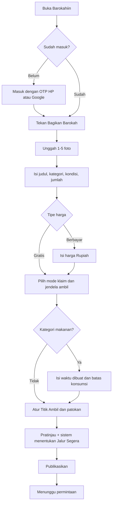
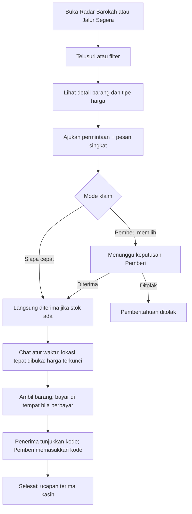
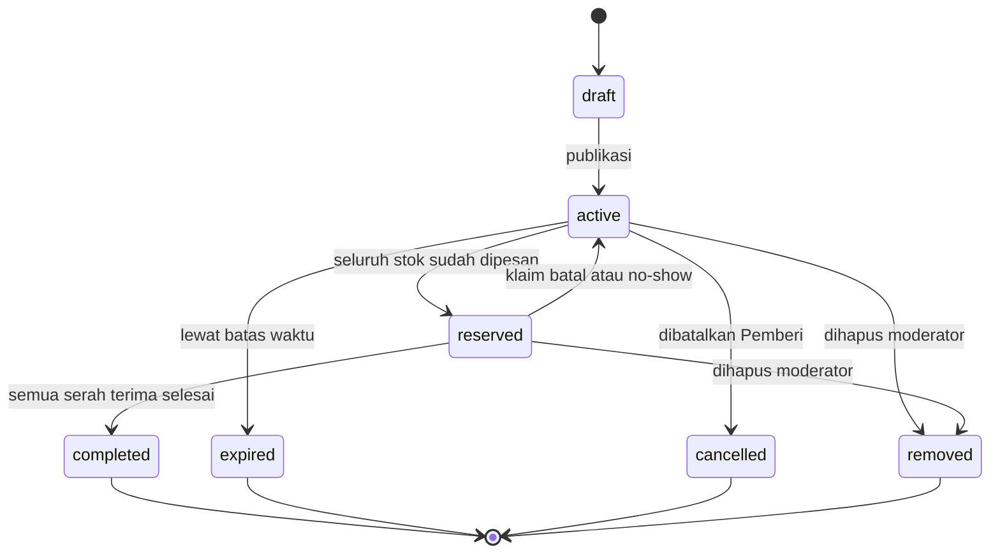
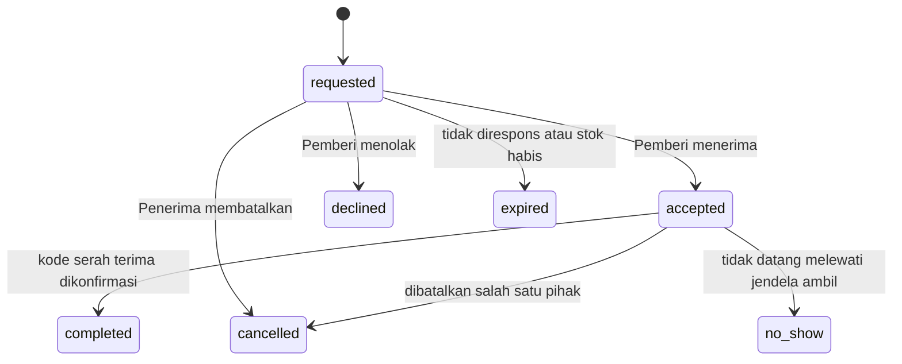

# PRD: Barokahiin

| | |
|---|---|
| **Versi** | 0.2 (draf untuk review tim UI/UX) |
| **Tanggal** | 17 November 2026 |
| **Pemilik produk** | _(isi nama)_ |
| **Status** | Draf. Jawaban pemilik produk sudah dimasukkan; beberapa keputusan menunggu rapat (lihat [Bagian 18](#18-keputusan-dan-pertanyaan-terbuka)) |
| **Pembaca** | UI/UX (utama), Frontend, Backend, QA |

> **Catatan jujur tentang isi dokumen ini.** Semua yang berlabel **[Asumsi]** atau **[Usulan]** belum divalidasi dengan pengguna nyata. Dokumen ini **tidak memuat data pasar atau statistik** karena belum ada sumber yang diberikan. Angka target ditulis _TBD_ sampai ada data dasar (baseline).

### Riwayat revisi
| Versi | Perubahan |
|---|---|
| 0.1 | Draf awal: berbagi barang gratis |
| 0.2 | Mengikuti jawaban pemilik produk: **barang gratis dan berbayar**, **makanan kemasan dan siap saji** dengan **Jalur Segera** untuk yang cepat kedaluwarsa, **PWA** sebagai platform, **kerangka verifikasi** disiapkan tapi tidak wajib, **dukungan sponsor**, **fokus awal Bandung dan sekitarnya**, serta fitur opsional untuk komunitas Muslim. Aspek legal, moderasi, dan merek ditunda sampai rapat |

---

## Cara membaca dokumen ini

| Tim | Baca terutama | Hasil yang diharapkan |
|---|---|---|
| **UI/UX** | Bagian 2–9, 11, 15 | Riset, user flow, wireframe, design system, uji usability |
| **Frontend** | Bagian 6–10, 12, 14 | Arsitektur UI, rute, state, performa, aksesibilitas |
| **Backend** | Bagian 6–10, 13, 14, 15 | Model data, API, aturan bisnis, keamanan, moderasi |
| **QA** | Bagian 10, 14, 15, 17 | Kriteria uji |

---

## 1. Ringkasan

**Barokahiin** adalah aplikasi web (PWA) tempat orang membagikan atau menawarkan barang dan makanan kepada orang di sekitarnya. Barang bisa **gratis** atau **berbayar**. Orang yang memasang barang (**Pemberi**) menampilkannya di aplikasi. Orang yang membutuhkan (**Penerima**) mencari barang di sekitarnya, mengajukan permintaan, lalu mengambilnya secara langsung.

**Proposisi nilai:**
- Untuk **Pemberi**: menyalurkan barang dan makanan lebih dengan cepat, aman, dan tepat sasaran.
- Untuk **Penerima**: menemukan kebutuhan dekat rumah, gratis atau dengan harga yang jelas.
- Untuk **komunitas** (masjid, pesantren, RT/RW, komunitas relawan): satu tempat untuk berbagi secara tertib.

**Pembeda utama:** Barokahiin bukan sekadar papan iklan. Fokusnya pada **kepastian barang sampai** (serah terima berkode), **keadilan** (Klaim Adil), **keamanan** (lokasi dikaburkan, chat tersamar), dan **ketepatan waktu** untuk makanan (Jalur Segera).

**Tagline [Usulan]:** "Berbagi yang barokah, dekat dari rumahmu."

---

## 2. Latar belakang dan masalah

**[Asumsi, perlu divalidasi lewat riset]**

1. Orang sering punya barang layak pakai atau makanan lebih, tetapi tidak tahu siapa yang membutuhkan di dekatnya.
2. Berbagi lewat grup chat atau media sosial berantakan: informasi cepat tenggelam, sulit dicari, dan tidak jelas siapa yang sudah mengambil.
3. Pemberi khawatir barang gratisnya diambil pihak yang menjualnya kembali, atau Penerima tidak jadi datang.
4. Penerima kadang malu atau tidak tahu harus meminta ke mana.
5. Makanan lebih (misalnya dari acara) cepat basi dan butuh penyaluran yang cepat dan tepat waktu.
6. Sebagian orang ingin melepas barang layak pakai atau makanan lebih dengan harga terjangkau, bukan gratis, tetapi tidak ingin repot memakai marketplace besar.

**Yang perlu dibuktikan dalam riset awal:** seberapa sering masalah ini dialami, bagaimana orang menyelesaikannya sekarang, dan apa yang membuat mereka mau atau tidak mau memakai aplikasi khusus.

---

## 3. Tujuan dan non-tujuan

### Tujuan
| # | Tujuan | Ukuran keberhasilan |
|---|---|---|
| T1 | Mempertemukan Pemberi dan Penerima dengan cepat dan dekat | Waktu dari posting ke permintaan pertama (TBD) |
| T2 | Memastikan barang benar-benar sampai ke tangan Penerima | Tingkat serah terima selesai (TBD) |
| T3 | Membangun rasa aman dan saling percaya | Laporan per 1.000 listing, tingkat no-show (TBD) |
| T4 | Mudah dipakai semua kalangan | Tingkat tugas utama berhasil pada uji usability (TBD) |
| T5 | Makanan cepat kedaluwarsa tersalurkan tepat waktu | Persentase makanan Segera yang berhasil diambil sebelum batas (TBD) |

### Non-tujuan (tidak dikerjakan di MVP)
- **Pembayaran di dalam aplikasi** (payment gateway, dompet, escrow). Barang berbayar dibayar **langsung saat serah terima**; aplikasi tidak memproses atau menyimpan uang.
- Lelang dan tawar-menawar terstruktur.
- Pengumpulan uang/donasi tunai.
- Pengiriman barang lewat kurir (hanya ambil langsung).
- Bahasa daerah (hanya Bahasa Indonesia, tetapi dibangun siap multi-bahasa).
- Verifikasi identitas yang diwajibkan (hanya disiapkan kerangkanya).

---

## 4. Pengguna dan peran

### Peran sistem
| Peran | Hak akses |
|---|---|
| **Tamu** | Melihat daftar dan detail barang (tanpa lokasi tepat). Tidak bisa meminta. |
| **Pengguna** | Satu akun bisa jadi **Pemberi** dan **Penerima**. |
| **Mitra (Rumah Barokah)** | Pengguna mewakili lembaga/komunitas. Memasang barang dalam jumlah banyak dan mengelola titik ambil (Fase 2). |
| **Moderator** | Meninjau laporan, mengambil tindakan konten dan akun. |
| **Admin** | Konfigurasi sistem, kategori, kebijakan, slot sponsor, laporan agregat. |

> **Catatan istilah untuk UI/UX:** "Pemberi" dipakai di dokumen ini untuk semua yang memasang barang. Apakah antarmuka perlu membedakan "Pemberi" (gratis) dan "Penjual" (berbayar) adalah keputusan desain (lihat Bagian 11).

### Persona awal **[Asumsi, bukan hasil riset]**
| Persona | Tujuan | Kekhawatiran |
|---|---|---|
| **Ibu rumah tangga yang merapikan rumah** (Pemberi) | Menyalurkan baju anak yang kekecilan, perabot | Takut dijual kembali, takut orang asing datang ke rumah |
| **Penyelenggara acara/pengajian** (Pemberi makanan) | Menyalurkan makanan lebih sebelum basi | Waktu sempit, tidak mau repot memilah penerima |
| **Pemilik usaha kecil/dapur rumahan** (Pemberi berbayar) | Menjual makanan lebih atau barang dengan harga murah ke sekitar | Takut pembeli tidak datang, bayar tidak jelas |
| **Mahasiswa perantau** (Penerima) | Mencari perabot, buku, makanan gratis atau murah | Malu meminta, tidak punya kendaraan, hemat kuota |
| **Keluarga yang sedang membutuhkan** (Penerima) | Perlengkapan sekolah dan bayi | Ingin proses yang bermartabat dan tidak dihakimi |
| **Pengurus masjid/komunitas** (Mitra) | Menyalurkan barang secara tertib ke warga sekitar | Antrean tidak adil, sulit mencatat |

> **Untuk tim UI/UX:** validasi persona ini lewat wawancara sebelum dijadikan dasar keputusan desain.

---

## 5. Konsep inti dan istilah

| Istilah | Arti |
|---|---|
| **Barokah** | Satu barang/paket yang ditawarkan (satu listing). |
| **Pemberi** | Pengguna yang memasang barang (gratis atau berbayar). |
| **Penerima** | Pengguna yang meminta dan mengambil barang. |
| **Tipe harga** | **Gratis** atau **Berbayar** (harga tetap dalam Rupiah). _Seikhlasnya_ menyusul di Fase 2. |
| **Klaim** | Permintaan Penerima atas sebuah Barokah. |
| **Titik Ambil** | Lokasi pengambilan: alamat Pemberi atau titik aman yang disepakati. |
| **Jalur Segera** | Bagian khusus untuk makanan yang cepat kedaluwarsa (lihat 5.2). |
| **Rumah Barokah** | Mitra komunitas/lembaga yang menyediakan titik ambil dan mengelola barang (Fase 2). |
| **Serah terima** | Proses pemberian dan pengambilan, dikonfirmasi dengan kode. |
| **Sahabat Berbagi** | Mode anonim: Pemberi tampil tanpa nama di publik. Label tampilan bisa dikonfigurasi, misalnya "Hamba Allah". |

### 5.1 Kategori barang **[Usulan]**
1. **Makanan Kemasan** (punya tanggal kedaluwarsa)
2. **Makanan Siap Saji** (dimasak/disiapkan, batas konsumsi pendek)
3. Minuman
4. Pakaian dan perlengkapan ibadah
5. Buku, Al-Qur'an, kitab, dan bahan bacaan
6. Perabot dan elektronik layak pakai
7. Perlengkapan bayi dan anak
8. Perlengkapan sekolah dan kuliah
9. Alat dan perkakas
10. Alat bantu kesehatan non-obat (kursi roda, tongkat, dsb.)
11. Tanaman dan bibit
12. Lainnya

Kategori dikelola admin (bisa ditambah tanpa mengubah kode). Kebijakan barang terlarang ada di [Bagian 15](#15-kepercayaan-keamanan-dan-moderasi).

### 5.2 Jalur Segera (makanan cepat kedaluwarsa)
Pemilik produk meminta makanan dengan waktu kedaluwarsa cepat **dipisahkan**. Rancangannya **[Usulan]**:

| Jenis | Masuk Jalur Segera bila |
|---|---|
| **Makanan Siap Saji** | **Selalu** (batas konsumsi dalam jam) |
| **Makanan Kemasan** | Sisa masa layak ≤ **N hari** (usulan awal N = 3, bisa diatur admin, TBD) |

Ciri Jalur Segera: tampil di bagian/tab terpisah, hitung mundur, urutan berdasarkan sisa waktu dan jarak, aturan lebih ketat (waktu dibuat dan batas konsumsi wajib), respons klaim lebih cepat, dan peringatan keamanan pangan.

---

## 6. Lingkup

### Cakupan geografis
- **Fokus awal (pilot): Bandung dan sekitarnya.** **[Asumsi]** mencakup Kota Bandung, Kota Cimahi, Kabupaten Bandung, dan Kabupaten Bandung Barat. Batas final ditentukan pemilik produk (lihat Bagian 18).
- **Teknis:** aplikasi tetap dapat diakses dari seluruh Indonesia dan data wilayah disiapkan nasional, supaya tidak perlu dibangun ulang saat meluas. Di luar area pilot, tampilkan pesan ramah: "Barokahiin belum ramai di wilayahmu. Jadilah yang pertama berbagi."
- Pencocokan bersifat **hiperlokal** (berdasarkan jarak), karena barang diambil langsung.
- Hierarki wilayah: Provinsi → Kabupaten/Kota → Kecamatan → Kelurahan/Desa. Gunakan sumber data wilayah resmi (misalnya kode wilayah Kemendagri/BPS) dan kunci versinya.
- **Zona waktu:** Bandung berada di WIB. Sistem tetap menyimpan waktu dalam UTC dan siap menampilkan WIB/WITA/WIT untuk perluasan.

### Platform
- **PWA mobile-first** (keputusan pemilik produk) + panel admin web.
- **[Asumsi]** Banyak pengguna memakai Android kelas menengah ke bawah dengan koneksi yang tidak stabil. Desain dan performa harus mengakomodasi ini (Bagian 14).
- Aplikasi native dipertimbangkan setelah ada data.

### Bahasa
Bahasa Indonesia. Semua teks ditaruh di berkas terjemahan (i18n) agar mudah menambah bahasa.

---

## 7. Saran fitur unggulan (pembeda Barokahiin)

Ini **usulan** untuk membedakan Barokahiin dari berbagi lewat grup chat atau marketplace biasa. Urutan berdasarkan dampak terhadap kepercayaan dan keberhasilan serah terima. _Usaha_: S kecil, M sedang, L besar.

| # | Fitur unggulan | Masalah yang dijawab | Ringkasan | Usaha | Fase |
|---|---|---|---|---|---|
| 1 | **Radar Barokah** | Sulit menemukan barang dekat | Daftar dan peta sekitar, filter kategori/harga/jarak. Lokasi publik dikaburkan | M | MVP |
| 2 | **Jalur Segera** | Makanan cepat basi | Bagian terpisah untuk makanan siap saji dan kemasan dengan masa layak pendek, hitung mundur, kabari saya | M | MVP |
| 3 | **Gratis dan Berbayar yang Jelas** | Orang ragu soal harga dan cara bayar | Label tipe harga yang jelas, harga **terkunci** saat klaim diterima, bayar di tempat saat serah terima, tanpa uang diproses aplikasi | M | MVP |
| 4 | **Klaim Adil** | Pemberi bingung memilih; penimbun | Mode *Siapa cepat* / *Pemberi memilih*, batas klaim aktif untuk barang gratis | M | MVP (Undian di Fase 2) |
| 5 | **Serah terima berkode** | Barang "hilang di jalan", sengketa | Kode 6 digit/QR dari Penerima dikonfirmasi Pemberi; untuk barang berbayar juga mencatat "pembayaran diterima" | S | MVP |
| 6 | **Sahabat Berbagi** (anonim) | Ingin menjaga privasi dan niat | Nama tampil anonim di publik; identitas tetap dikenal sistem | S | MVP |
| 7 | **Kerangka kepercayaan bertingkat** | Akun palsu, penipuan | Level kepercayaan dan tabel verifikasi **disiapkan**, belum diwajibkan. Lencana dari riwayat serah terima, bukan bintang ulasan | M | MVP (kerangka) |
| 8 | **Chat tersamar** | Bocornya nomor pribadi | Chat per klaim; nomor HP tidak tampil kecuali dibagikan dengan persetujuan | M | MVP |
| 9 | **Hemat data dan tahan koneksi buruk** | Jaringan tidak merata | Kompresi gambar, tampilan ringan, percobaan ulang, mode hemat data | M | MVP |
| 10 | **Mode Komunitas Muslim (opsional)** | Kebutuhan khusus komunitas | Label anonim "Hamba Allah", kategori perlengkapan ibadah, filter info halal (diisi Pemberi), dan nanti jendela ambil ramah waktu salat. Bersifat **opsional**, bukan default | S–M | MVP (label, kategori, filter), Fase 2 (jendela salat) |
| 11 | **Dukungan Sponsor yang Transparan** | Pembiayaan operasional | Slot "Didukung oleh" berlabel jelas; sponsor **tidak** memengaruhi urutan hasil dan **tidak** menerima data pengguna | S | MVP (dasar) |
| 12 | **Butuh Barokah** (papan kebutuhan) | Daerah sepi pemberi; Penerima malu bertanya | Penerima memposting kebutuhan (boleh anonim di publik), Pemberi memenuhi | M | Fase 2 |
| 13 | **Seikhlasnya** | Ingin berbagi dengan kontribusi sukarela | Tipe harga ketiga: Penerima memberi seikhlasnya langsung saat serah terima | S | Fase 2 |
| 14 | **Rumah Barokah** (mitra komunitas) | Keamanan bertemu orang asing, penyaluran skala besar | Masjid, komunitas, RT/RW jadi titik ambil aman dan penyalur terverifikasi | L | Fase 2 |
| 15 | **Jejak Kebaikan** (dampak pribadi) | Motivasi berkelanjutan | Ringkasan pribadi. **Tanpa papan peringkat publik** agar tidak jadi ajang pamer | S | Fase 2 |
| 16 | **Bantuan pintar (AI)** | Posting lama, barang terlarang lolos | Saran kategori/judul dari foto, deteksi barang terlarang untuk membantu moderator | L | Fase 3 |
| 17 | **Pembayaran dalam aplikasi** | Praktis dan aman bagi sebagian orang | Menunggu keputusan bisnis dan kepatuhan | L | Fase 3 (opsional) |

**Rekomendasi fokus MVP:** fitur 1–9, 10 (versi dasar), dan 11 (versi dasar).

### Strategi cold start di Bandung **[Usulan]**
1. Mulai dari **komunitas yang sudah berkumpul**: area kampus dan kos-kosan, komunitas relawan, masjid dan pengajian, lingkungan RT/RW.
2. Isi awal dengan **Pemberi yang dibina langsung** (misalnya penyelenggara acara dan dapur rumahan) agar Radar tidak kosong saat pengguna pertama datang.
3. Pantau satu kecamatan sebagai "wilayah percontohan" sebelum memperluas, dan ukur metrik pencocokan di sana.
4. Saat area masih sepi, tampilkan ajakan jadi Pemberi pertama dan perluas radius otomatis dengan label jarak.

---

## 8. Prioritas dan fase rilis

| Fase | Isi | Tujuan fase |
|---|---|---|
| **MVP (P0)** | Akun, posting barang (gratis/berbayar), Jalur Segera, penelusuran, klaim (2 mode), chat, serah terima berkode, notifikasi dasar, laporan dan moderasi dasar, slot sponsor dasar, kerangka verifikasi, panel admin dasar | Membuktikan barang benar-benar berpindah tangan di Bandung |
| **Fase 2 (P1)** | Butuh Barokah, Seikhlasnya, Rumah Barokah, mode Undian, Jejak Kebaikan, jendela ambil ramah salat, verifikasi aktif (bila diputuskan), notifikasi WhatsApp, manajemen sponsor lengkap | Skala dan kepercayaan |
| **Fase 3 (P2)** | Bantuan AI, bahasa daerah, pembayaran dalam aplikasi (opsional), pengiriman opsional, aplikasi native | Efisiensi dan jangkauan |

---

## 9. User flow utama

### 9.1 Pemberi memasang barang

### 9.2 Penerima mengambil barang

### 9.3 Status Barokah (listing)

### 9.4 Status Klaim

---

## 10. Kebutuhan fungsional

Prioritas: **P0** = MVP, **P1** = Fase 2, **P2** = Fase 3. Setiap kebutuhan punya kriteria penerimaan (KP) sebagai dasar desain, pengembangan, dan uji.

### 10.1 Akun dan profil (AUTH)

| ID | Kebutuhan | P | Kriteria penerimaan |
|---|---|---|---|
| AUTH-01 | Masuk dengan OTP nomor HP | P0 | OTP berlaku terbatas; ada batas percobaan; nomor HP tidak tampil ke pengguna lain |
| AUTH-02 | Masuk dengan Google | P0 | Akun yang sama tidak terduplikasi bila email/HP sama |
| AUTH-03 | Profil dasar: nama tampil, foto (opsional), wilayah | P0 | Nama tampil boleh bukan nama asli; wilayah dipilih sampai kecamatan |
| AUTH-04 | Mode Sahabat Berbagi (anonim publik) | P0 | Bila aktif, nama dan foto tidak tampil di listing/chat publik; moderator tetap bisa melihat identitas |
| AUTH-05 | Level kepercayaan: L0 tamu, L1 HP terverifikasi | P0 | L0 hanya melihat; L1 boleh memposting dan meminta |
| AUTH-06 | **Kerangka verifikasi (disiapkan, tidak diwajibkan)** | P0 (kerangka) | Model data verifikasi, status, dan *feature flag* tersedia; antarmuka tempat verifikasi disiapkan tetapi **tidak ditampilkan/diwajibkan**; tidak ada pengumpulan dokumen identitas di MVP |
| AUTH-07 | Hapus akun dan data | P0 | Pengguna bisa mengajukan; data pribadi dihapus/dianonimkan sesuai kebijakan retensi |
| AUTH-08 | Pengaturan notifikasi | P0 | Bisa mengatur jenis notifikasi per kanal |

### 10.2 Memasang barang (LST)

| ID | Kebutuhan | P | Kriteria penerimaan |
|---|---|---|---|
| LST-01 | Buat listing: judul, deskripsi, kategori, kondisi, jumlah, 1–5 foto | P0 | Validasi wajib/opsional jelas; foto dikompresi sebelum unggah; draf tersimpan otomatis |
| LST-02 | Mode klaim: *Siapa cepat* atau *Pemberi memilih* | P0 | Mode terkunci setelah ada klaim pertama |
| LST-03 | Jendela ambil (tanggal dan jam mulai–selesai) | P0 | Zona waktu mengikuti lokasi; wajib untuk makanan |
| LST-04 | **Atribut Makanan Kemasan**: tanggal kedaluwarsa, bahan/alergen, info halal (diisi Pemberi) | P0 | Tanggal kedaluwarsa wajib dan tidak boleh sudah lewat; info halal berlabel "diisi Pemberi, tidak diverifikasi" |
| LST-05 | **Atribut Makanan Siap Saji**: waktu dibuat/dimasak, **batas konsumsi**, bahan/alergen, info halal | P0 | Batas konsumsi wajib; jendela ambil tidak boleh melewati batas konsumsi; tampil peringatan keamanan pangan |
| LST-06 | Titik Ambil: pilih lokasi di peta + patokan teks (RT/RW, ciri bangunan) | P0 | Lokasi publik **dikaburkan**; alamat tepat hanya terbuka setelah klaim diterima |
| LST-07 | Edit, tutup lebih awal, perpanjang, duplikat listing | P0 | Perubahan penting memberi tahu Penerima yang sudah diterima; **harga tidak bisa diubah** untuk klaim yang sudah diterima |
| LST-08 | Batas posting harian dan batas listing aktif per pengguna | P0 | Nilai bisa diatur admin (konfigurasi) |
| LST-09 | Posting massal untuk Mitra | P1 | Impor berkas atau form berulang |
| LST-10 | Mode Undian | P1 | Pemilihan acak dari peminta saat batas waktu; hasil dapat diaudit |

### 10.3 Harga dan pembayaran (PRC)

| ID | Kebutuhan | P | Kriteria penerimaan |
|---|---|---|---|
| PRC-01 | Tipe harga **Gratis** atau **Berbayar** | P0 | Label tipe harga tampil jelas di kartu, detail, dan chat; tidak bisa disalahartikan |
| PRC-02 | Harga berbayar dalam Rupiah bilangan bulat | P0 | Tampil format Indonesia ("Rp 25.000"); harga wajib > 0 untuk berbayar |
| PRC-03 | **Harga terkunci** saat klaim diterima | P0 | Perubahan harga pada listing tidak memengaruhi klaim yang sudah diterima |
| PRC-04 | **Bayar di tempat saat serah terima**; aplikasi tidak memproses uang | P0 | Layar detail dan klaim menjelaskan cara bayar dan mengingatkan "periksa barang sebelum membayar" |
| PRC-05 | Konfirmasi "pembayaran sudah diterima" oleh Pemberi saat serah terima barang berbayar | P0 | Tercatat sebagai bagian konfirmasi serah terima; tidak menyimpan data rekening/kartu |
| PRC-06 | Filter dan urutan berdasarkan tipe harga dan harga | P0 | Bisa memilih Gratis saja, Berbayar saja, atau semuanya |
| PRC-07 | Laporan khusus: harga tidak sesuai, minta bayar di muka, barang tidak sesuai deskripsi | P0 | Jalur pelaporan terpisah dengan konteks klaim |
| PRC-08 | Tipe harga **Seikhlasnya** | P1 | Tidak ada nominal wajib; dibayar langsung saat serah terima |
| PRC-09 | Pembayaran dalam aplikasi | P2 | Menunggu keputusan bisnis dan kepatuhan; **tidak dikerjakan** sebelum diputuskan |

### 10.4 Jalur Segera (URG)

| ID | Kebutuhan | P | Kriteria penerimaan |
|---|---|---|---|
| URG-01 | Klasifikasi otomatis ke Jalur Segera berdasarkan aturan 5.2 | P0 | Ambang batas dapat diatur admin; listing berpindah otomatis saat mendekati batas |
| URG-02 | Tab/bagian terpisah "Segera" di Radar | P0 | Urut berdasarkan sisa waktu lalu jarak; menampilkan hitung mundur dan label kategori (Siap Saji/Kemasan) |
| URG-03 | Hitung mundur dan penutupan otomatis | P0 | Tampil sisa waktu akurat berdasarkan jam server; listing otomatis ditutup saat batas lewat |
| URG-04 | Respons klaim lebih cepat | P0 | Klaim yang belum diputuskan kedaluwarsa otomatis dalam waktu pendek (nilai diatur admin, TBD) |
| URG-05 | "Kabari saya" untuk makanan Segera di wilayah pilihan | P1 | Notifikasi sesuai wilayah dan kategori; bisa dimatikan |
| URG-06 | Peringatan keamanan pangan di detail dan saat klaim | P0 | Muncul untuk semua makanan; tidak bisa dilewati tanpa dilihat sebelum klaim |

### 10.5 Menemukan barang (DSC)

| ID | Kebutuhan | P | Kriteria penerimaan |
|---|---|---|---|
| DSC-01 | Daftar "Di sekitar saya" dengan radius dan jarak perkiraan | P0 | Berfungsi dengan izin lokasi **atau** pilihan wilayah manual |
| DSC-02 | Tampilan peta dengan penanda dikaburkan | P0 | Ada alternatif daftar bagi yang tidak memakai peta |
| DSC-03 | Filter: kategori, kondisi, jarak, tipe harga, "berakhir segera", info halal | P0 | Filter bisa dihapus satu per satu |
| DSC-04 | Pencarian kata kunci | P0 | Toleran salah ketik ringan; hasil urut relevansi atau jarak |
| DSC-05 | Detail barang: foto, info, jarak, tipe harga, status, profil singkat Pemberi, tombol aksi | P0 | Menampilkan status dengan jelas (tersedia/dipesan/selesai/kedaluwarsa) |
| DSC-06 | Simpan/favorit dan peringatan wilayah-kategori | P1 | Notifikasi bila ada barang baru yang sesuai |
| DSC-07 | Tampilan saat area sepi atau di luar area pilot | P0 | Ajakan jadi Pemberi pertama dan perluas radius otomatis dengan label jarak |

### 10.6 Klaim dan serah terima (CLM)

| ID | Kebutuhan | P | Kriteria penerimaan |
|---|---|---|---|
| CLM-01 | Ajukan klaim + pesan singkat + jumlah | P0 | Tidak bisa klaim barang sendiri; tidak bisa klaim ganda pada listing yang sama |
| CLM-02 | Batas klaim aktif per pengguna | P0 | Batas **barang gratis** (usulan awal 3) dan batas **barang berbayar** diatur terpisah oleh admin |
| CLM-03 | Pemberi menerima/menolak (mode *Pemberi memilih*) | P0 | Penolakan boleh dengan alasan standar; Penerima diberi tahu |
| CLM-04 | Penerimaan otomatis (mode *Siapa cepat*) | P0 | Aman terhadap permintaan bersamaan: stok tidak boleh terlampaui |
| CLM-05 | Atur waktu ambil dalam jendela yang tersedia | P0 | Alamat tepat terbuka hanya untuk klaim berstatus diterima |
| CLM-06 | Serah terima berkode (6 digit atau QR) | P0 | Kode milik Penerima, dikonfirmasi Pemberi; hanya berlaku untuk klaim itu; boleh konfirmasi manual bila kamera/jaringan bermasalah |
| CLM-07 | Pembatalan oleh kedua pihak dengan alasan | P0 | Stok kembali bila klaim batal |
| CLM-08 | Penanganan no-show | P0 | Setelah jendela berakhir tanpa serah terima, Pemberi bisa menandai no-show; Penerima bisa membantah |
| CLM-09 | Ucapan terima kasih (bukan bintang ulasan) | P0 | Pilihan singkat positif; laporan masalah lewat jalur terpisah |

### 10.7 Chat (CHT)

| ID | Kebutuhan | P | Kriteria penerimaan |
|---|---|---|---|
| CHT-01 | Chat per klaim (hanya Pemberi dan Penerima terkait) | P0 | Teks dan emoji; foto opsional P1 |
| CHT-02 | Peringatan bila terdeteksi nomor HP, tautan, atau permintaan uang di muka | P0 | Peringatan tidak memblokir, tetapi menjelaskan risiko |
| CHT-03 | Tombol laporkan dan blokir di chat | P0 | Pelaporan menyertakan konteks percakapan |
| CHT-04 | Bagikan kontak WhatsApp secara sukarela | P1 | Hanya dengan persetujuan eksplisit kedua pihak |

### 10.8 Notifikasi (NTF)

| ID | Kebutuhan | P | Kriteria penerimaan |
|---|---|---|---|
| NTF-01 | Notifikasi dalam aplikasi dan push untuk: klaim baru, diterima/ditolak, pesan baru, pengingat ambil, listing akan berakhir | P0 | Pengguna bisa mengatur per jenis; tidak ada notifikasi ganda |
| NTF-02 | Email untuk kejadian penting | P1 | Opsional |
| NTF-03 | WhatsApp untuk pengingat | P1 | Memerlukan persetujuan pengguna dan biaya penyedia |

### 10.9 Preferensi komunitas Muslim (COM), opsional

| ID | Kebutuhan | P | Kriteria penerimaan |
|---|---|---|---|
| COM-01 | Label anonim yang dapat dikonfigurasi (misalnya "Hamba Allah") | P0 | Admin dapat mengatur teks; default netral ("Sahabat Berbagi") |
| COM-02 | Kategori perlengkapan ibadah dan bahan bacaan keagamaan | P0 | Tersedia sebagai kategori biasa |
| COM-03 | Filter info halal (berdasarkan isian Pemberi) | P0 | Label tegas "diisi Pemberi, tidak diverifikasi"; tidak ada klaim sertifikasi |
| COM-04 | Jendela ambil ramah waktu salat | P1 | Opsional per pengguna; tidak mengubah tampilan bagi yang tidak memakainya |

> Prinsip: antarmuka **default netral dan inklusif**; fitur komunitas Muslim bersifat opsional agar pengguna umum tetap nyaman.

### 10.10 Dukungan sponsor (SPN)

| ID | Kebutuhan | P | Kriteria penerimaan |
|---|---|---|---|
| SPN-01 | Slot "Didukung oleh" di tempat yang telah ditentukan (misalnya beranda bawah dan halaman Tentang) | P0 | Tidak menutupi aksi utama; tidak mengganggu alur klaim/serah terima |
| SPN-02 | Label jelas "Disponsori" / "Didukung oleh" | P0 | Selalu terlihat dan dibedakan dari konten listing |
| SPN-03 | Sponsor **tidak memengaruhi urutan** hasil pencarian atau Radar | P0 | Aturan tertulis dan diuji |
| SPN-04 | Data pengguna **tidak dibagikan** ke sponsor | P0 | Pelaporan ke sponsor hanya angka agregat |
| SPN-05 | Admin mengelola slot: konten, periode tayang, tautan | P1 | Perubahan tercatat |
| SPN-06 | Laporan tayang agregat | P1 | Tanpa data pribadi |

### 10.11 Butuh Barokah (WSH), Fase 2

| ID | Kebutuhan | P | Kriteria penerimaan |
|---|---|---|---|
| WSH-01 | Penerima memposting kebutuhan | P1 | Boleh tampil anonim di publik; ada batas posting |
| WSH-02 | Pemberi menawarkan barang untuk memenuhi kebutuhan | P1 | Menghubungkan ke alur klaim biasa |
| WSH-03 | Penerima menutup kebutuhan setelah terpenuhi | P1 | Status "terpenuhi" |

### 10.12 Mitra / Rumah Barokah (PRT), Fase 2

| ID | Kebutuhan | P | Kriteria penerimaan |
|---|---|---|---|
| PRT-01 | Pendaftaran dan verifikasi Mitra oleh admin | P1 | Syarat verifikasi ditentukan kemudian |
| PRT-02 | Halaman profil Mitra + jam layanan + alamat | P1 | Menjadi opsi Titik Ambil aman |
| PRT-03 | Beberapa pengelola dalam satu Mitra | P1 | Peran: pemilik, pengelola |
| PRT-04 | Laporan penyaluran Mitra | P1 | Ringkasan periode, dapat diunduh |

### 10.13 Moderasi dan admin (ADM)

| ID | Kebutuhan | P | Kriteria penerimaan |
|---|---|---|---|
| ADM-01 | Laporkan listing/pengguna/pesan dengan alasan standar | P0 | Pelapor dapat konfirmasi; identitas pelapor tidak dibuka ke terlapor |
| ADM-02 | Antrean moderasi dengan prioritas dan riwayat tindakan | P0 | Setiap tindakan tercatat (siapa, kapan, alasan) |
| ADM-03 | Tindakan: peringatan, sembunyikan, hapus, batasi, tangguhkan akun | P0 | Pengguna diberi tahu alasan dan jalur banding |
| ADM-04 | Konfigurasi: kategori, batas, ambang Jalur Segera, label anonim, teks kebijakan | P0 | Perubahan konfigurasi tercatat |
| ADM-05 | Dasbor metrik inti | P0 | Lihat bagian 16 |
| ADM-06 | Pencarian pengguna/listing/klaim untuk dukungan | P0 | Data pribadi ditampilkan seminimal mungkin dan akses tercatat |

> Prosedur moderasi lengkap (tim, jam layanan, SLA) ditunda sampai rapat (Bagian 18). Kebutuhan di atas adalah **kemampuan sistem** yang tetap diperlukan.

---

## 11. Brief untuk tim UI/UX

### Prinsip desain
1. **Bermartabat.** Penerima tidak boleh merasa dihakimi atau dikasihani. Bahasa netral dan hangat.
2. **Tenang dan jelas.** Satu aksi utama per layar.
3. **Gratis vs berbayar tidak boleh membingungkan.** Tipe harga selalu terlihat dan cara bayar dijelaskan sebelum klaim.
4. **Aman secara default.** Informasi sensitif (alamat, nomor HP) tersembunyi sampai perlu; jelaskan alasannya di antarmuka.
5. **Mudah untuk semua.** Teks jelas, bahasa sederhana, bisa dipakai pengguna baru teknologi dan usia lanjut.
6. **Ringan.** Rancang untuk layar kecil (sekitar 360 px), koneksi lambat, dan kuota terbatas.
7. **Inklusif.** Default netral untuk umum. Fitur dan istilah komunitas Muslim ("Hamba Allah", info halal, jendela salat) bersifat opsional dan tidak dipaksakan.
8. **Sponsor dengan etika.** Sponsor selalu berlabel, tidak menyerupai listing, dan tidak mengganggu alur utama.

### Layar yang perlu dirancang (MVP)
| Area | Layar |
|---|---|
| Onboarding | Sambutan, izin lokasi (dengan alasan), pilih wilayah manual, masuk/OTP |
| Beranda | Radar Barokah (daftar), peta, filter, pencarian, tab **Segera**, kondisi sepi/di luar area pilot, slot sponsor |
| Detail barang | Semua status listing; **tipe harga dan cara bayar**; atribut makanan; peringatan keamanan pangan; tombol aksi sesuai peran |
| Posting | Alur bertahap: foto → info → **tipe harga** → atribut makanan (bila perlu) → mode klaim/jendela → lokasi → pratinjau |
| Klaim | Form klaim, status klaim (termasuk harga terkunci), daftar klaim saya |
| Pemberi | Kelola listing, daftar peminta, terima/tolak |
| Serah terima | Kode/QR (Penerima), input/scan kode + konfirmasi pembayaran (Pemberi), layar sukses |
| Chat | Daftar percakapan, percakapan, peringatan keamanan |
| Profil | Profil, level kepercayaan, mode anonim, pengaturan notifikasi, hapus akun |
| Bantuan | Panduan aman berbagi dan bertransaksi, aturan barang, laporan |
| Tentang | Informasi aplikasi dan sponsor |

### Kondisi wajib didesain di setiap layar
Memuat, kosong, error, offline/koneksi buruk, sukses, tidak ada izin (lokasi/kamera/notifikasi), stok habis/kedaluwarsa, **harga berubah/barang sudah diambil orang lain**, dan **listing Segera yang hampir habis waktu**.

### Pertanyaan desain yang perlu dijawab lewat riset
- Seberapa nyaman Penerima meminta barang kepada orang asing? Apa yang membuat mereka merasa aman?
- Apakah pengguna paham beda gratis dan berbayar dengan cepat? Perlukah antarmuka membedakan "Pemberi" dan "Penjual"?
- Bagaimana menampilkan Jalur Segera agar terasa mendesak tetapi tidak membuat panik?
- Di mana slot sponsor boleh tampil tanpa merusak kepercayaan?
- Apakah Pemberi lebih suka memilih sendiri atau sistem yang memilih?
- Seberapa penting peta dibanding daftar bagi pengguna di kota dan di pinggiran Bandung?
- Bagaimana istilah "barokah" dipahami pengguna umum dan lintas keyakinan?
- Hal apa yang membuat Pemberi ragu memasang barang atau makanan?

### Aksesibilitas dan konten
- Target **WCAG 2.2 AA**: kontras teks ≥ 4,5:1, sasaran sentuh ≥ 44×44 px, tidak mengandalkan warna saja, fokus terlihat, mendukung pembaca layar. Hitung mundur harus dapat dibaca pembaca layar tanpa membanjiri pengumuman.
- Microcopy: pesan error menjelaskan masalah dan cara memperbaikinya. Teks kosong mengarahkan tindakan.
- Hindari *dark pattern*: tidak ada paksaan membagikan lokasi/kontak, tidak ada rasa bersalah untuk memancing posting, tidak ada tekanan palsu ("tinggal 1!") yang tidak benar.
- Pakai data contoh palsu pada mockup (tanpa NIK, nomor HP, atau alamat asli).

### Yang diharapkan dari UI/UX sebelum diserahkan ke developer
User flow lengkap (jalur sukses dan gagal), wireframe → desain visual, design system (token + komponen + semua status), spesifikasi responsif, spesifikasi handoff (jarak, token, perilaku interaksi, aksesibilitas), dan hasil uji usability awal.

---

## 12. Catatan untuk tim Frontend

> Berikut **usulan**; stack final ditentukan tim teknis.

### Rute (usulan)
| Rute | Layar | Akses |
|---|---|---|
| `/` | Radar Barokah | Publik |
| `/segera` | Jalur Segera | Publik |
| `/barokah/:id` | Detail barang | Publik (info terbatas), lengkap bila masuk |
| `/bagikan` | Posting barang | Masuk (L1) |
| `/klaim` | Klaim saya | Masuk |
| `/kelola` | Listing saya dan peminta | Masuk |
| `/chat/:claimId` | Percakapan | Pihak terkait |
| `/serah-terima/:claimId` | Kode/scan serah terima | Pihak terkait |
| `/profil`, `/pengaturan` | Profil dan pengaturan | Masuk |
| `/bantuan`, `/aturan`, `/tentang` | Bantuan, kebijakan, tentang | Publik |
| `/admin/*` | Panel admin | Moderator/Admin |

### Kebutuhan teknis
- **PWA mobile-first**: dapat dipasang di layar utama, cache aset dasar, halaman offline yang informatif, pembaruan versi yang mulus.
- **State**: data server dikelola dengan pustaka data-fetching (cache, retry, invalidasi); state UI tetap lokal. Draf posting disimpan lokal agar tidak hilang saat koneksi putus.
- **Unggah gambar**: kompres dan ubah ukuran di klien sebelum unggah; tampilkan progres; bisa diulang saat gagal. _(Target ukuran, TBD)_
- **Peta**: muat malas (lazy), alternatif daftar selalu tersedia. Klien **tidak pernah** menerima koordinat tepat untuk pengguna yang tidak berhak.
- **Harga**: tampilkan dalam format Rupiah Indonesia; nilai berasal dari server (bilangan bulat), jangan dihitung ulang di klien.
- **Hitung mundur Jalur Segera**: sinkronkan dengan jam server (jangan percaya jam perangkat) dan hentikan saat tab tidak aktif untuk hemat baterai.
- **Waktu**: tampilkan dengan zona waktu lokasi barang dan tulis kodenya (WIB/WITA/WIT) di jam ambil.
- **Real-time**: pembaruan status klaim dan chat lewat WebSocket/SSE atau polling dengan fallback.
- **Slot sponsor**: komponen tersendiri yang dimuat dari konfigurasi; tidak boleh memblokir render konten utama.
- **i18n**: semua teks dari berkas terjemahan; format tanggal/angka lokal Indonesia.
- **Analitik**: lihat bagian 16.
- **Keamanan klien**: tidak ada rahasia di kode; sanitasi tampilan konten pengguna (cegah XSS); hindari menyimpan token di tempat yang mudah dicuri bila ada alternatif cookie `HttpOnly`.
- **Konkurensi**: tombol aksi (klaim, terima) dinonaktifkan saat proses berjalan; tangani respons "stok sudah habis" dengan jelas.
- **Kerangka verifikasi**: siapkan komponen dan rute verifikasi di balik *feature flag* yang **mati** di MVP.

---

## 13. Catatan untuk tim Backend

> Berikut **usulan**; teknologi final ditentukan tim teknis.

### Arsitektur (usulan)
Aplikasi modular (*modular monolith*) dengan lapisan: **API → layanan (aturan bisnis) → akses data**. Modul: akun, listing, harga, klaim, Jalur Segera, chat, notifikasi, moderasi, wilayah, sponsor. Pekerjaan latar belakang (kedaluwarsa listing, klasifikasi Segera, pengingat, notifikasi, kompresi gambar) memakai antrean/job. Penyimpanan gambar di object storage dengan CDN.

Basis data relasional dengan dukungan **geospasial** (pencarian radius dan indeks spasial) sangat disarankan. Pencarian teks bisa dimulai dari fitur bawaan basis data.

### Model data utama
| Entitas | Atribut kunci |
|---|---|
| **User** | id, no_hp (terenkripsi/hash untuk pencarian), email, nama_tampil, foto, wilayah_id, level_kepercayaan, mode_anonim, status, dibuat_pada |
| **Verification** _(disiapkan)_ | id, user_id, tipe, status, penyedia, referensi_eksternal, diperbarui_pada. **Tidak menyimpan NIK mentah** |
| **Region** | id, tingkat, induk_id, nama, kode_resmi, zona_waktu |
| **Category** | id, nama, jenis (umum / makanan_kemasan / makanan_siap_saji), aturan |
| **Listing** | id, pemberi_id, judul, deskripsi, kategori_id, kondisi, stok_total, stok_tersedia, mode_klaim, **tipe_harga** (gratis/berbayar), **harga_rupiah** (integer, null bila gratis), status, wilayah_id, lokasi_publik (dikaburkan), lokasi_tepat (terenkripsi), patokan, ambil_mulai, ambil_selesai, **kedaluwarsa_pada**, **batas_konsumsi_pada**, **jalur_segera** (boolean, turunan), atribut_makanan (JSON), dibuat/diubah |
| **ListingImage** | id, listing_id, url, urutan |
| **Claim** | id, listing_id, penerima_id, jumlah, pesan, status, **harga_terkunci_rupiah**, kode_serah_terima (hash), jadwal_ambil, diputuskan_pada, **pembayaran_dikonfirmasi_pada**, selesai_pada |
| **Conversation / Message** | id, claim_id, pengirim_id, isi, dibuat_pada, status_baca |
| **Report** | id, pelapor_id, target_tipe, target_id, alasan, bukti, status, penangan_id |
| **ModerationAction** | id, moderator_id, target, tindakan, alasan, dibuat_pada |
| **Notification** | id, user_id, jenis, payload, kanal, status |
| **SponsorSlot** | id, nama_sponsor, penempatan, konten, tautan, periode_mulai, periode_selesai, aktif |
| **Partner** | id, nama, jenis, alamat, jam_layanan, status_verifikasi (P1) |
| **Wish (Butuh Barokah)** | id, user_id, judul, kategori_id, wilayah_id, status (P1) |
| **Config** | kunci, nilai, diubah_oleh, diubah_pada (batas klaim, ambang Segera, label anonim, dll.) |
| **AuditLog** | id, aktor, aksi, target, waktu (untuk tindakan sensitif) |

### Aturan bisnis penting
1. **Stok tidak boleh terlampaui.** Penerimaan klaim otomatis aman terhadap permintaan bersamaan (transaksi + penguncian/pembaruan atomik).
2. **Alamat dan koordinat tepat** hanya dikembalikan API untuk Pemberi dan Penerima dengan klaim **accepted**. Koordinat publik dikaburkan di server (radius pengaburan diatur konfigurasi).
3. **Harga terkunci**: saat klaim berstatus accepted, `harga_terkunci_rupiah` disalin dari listing dan tidak berubah meski listing diedit.
4. **Tidak ada pemrosesan uang** di MVP. Sistem hanya mencatat bahwa Pemberi mengonfirmasi pembayaran diterima. Tidak menyimpan nomor rekening/kartu.
5. **Klasifikasi Jalur Segera**: job terjadwal menghitung `jalur_segera` dari jenis makanan, `kedaluwarsa_pada`, `batas_konsumsi_pada`, dan ambang konfigurasi (aturan 5.2).
6. **Kedaluwarsa otomatis**: listing yang melewati `kedaluwarsa_pada`/`batas_konsumsi_pada` menjadi `expired`; klaim yang belum diputuskan menjadi `expired`. Klaim pending Jalur Segera kedaluwarsa dalam waktu lebih pendek (konfigurasi).
7. **Validasi makanan**: jendela ambil tidak boleh melewati `batas_konsumsi_pada`; tanggal kedaluwarsa tidak boleh di masa lalu.
8. **Serah terima**: kode dibuat saat klaim diterima, disimpan sebagai hash, dibatasi percobaan. Konfirmasi mengubah klaim menjadi `completed`. Untuk berbayar, konfirmasi menyertakan penanda pembayaran diterima.
9. **No-show**: dihitung per pengguna dalam jangka waktu tertentu; ambang dan sanksi dapat dikonfigurasi (usulan awal: 3 kali dalam 30 hari, TBD).
10. **Batas klaim aktif** untuk barang gratis dan berbayar dikonfigurasi terpisah.
11. **Idempoten**: endpoint pembuatan klaim dan konfirmasi serah terima menerima kunci idempotensi.
12. **Soft delete** untuk listing/klaim yang berkaitan dengan laporan, supaya bukti tidak hilang.
13. **Sponsor tidak memengaruhi pemeringkatan**: pengurutan hasil tidak boleh membaca data sponsor. Data pengguna tidak dikirim ke sponsor.
14. **Verifikasi** berada di balik *feature flag* dan tidak menjadi syarat memposting/klaim di MVP.

### Rancangan API (draf, `/api/v1`)
Autentikasi: token berumur pendek + refresh. Daftar memakai paginasi **cursor**. Format error konsisten: `{ "error": { "code", "message", "fields?" } }`.

| Metode | Endpoint | Akses | Fungsi |
|---|---|---|---|
| POST | `/auth/otp/request` | Publik | Minta OTP |
| POST | `/auth/otp/verify` | Publik | Verifikasi OTP, terbitkan token |
| POST | `/auth/google` | Publik | Masuk dengan Google |
| POST | `/auth/refresh` | Token refresh | Perbarui token |
| GET/PATCH | `/me` | Masuk | Lihat/ubah profil, mode anonim |
| DELETE | `/me` | Masuk | Ajukan penghapusan akun |
| GET | `/me/verification` | Masuk | Status verifikasi (MVP: tidak diwajibkan) |
| GET | `/regions` | Publik | Telusuri hierarki wilayah |
| GET | `/categories` | Publik | Daftar kategori dan aturannya |
| GET | `/listings` | Publik | Cari (lokasi/radius, wilayah, kategori, kata kunci, `price_type`, `urgent`, halal, dll.) |
| GET | `/listings/urgent` | Publik | Jalur Segera (urut sisa waktu, jarak) |
| POST | `/listings` | L1 | Buat listing |
| GET | `/listings/{id}` | Publik | Detail (field sesuai hak akses) |
| PATCH | `/listings/{id}` | Pemilik | Ubah |
| POST | `/listings/{id}/close` | Pemilik | Tutup/batalkan |
| POST | `/media/uploads` | L1 | Dapatkan URL unggah gambar |
| POST | `/listings/{id}/claims` | L1 | Ajukan klaim (idempoten) |
| GET | `/me/claims` | Masuk | Klaim saya |
| GET | `/listings/{id}/claims` | Pemilik | Peminta pada listing saya |
| POST | `/claims/{id}/accept` | Pemilik | Terima (mengunci harga) |
| POST | `/claims/{id}/decline` | Pemilik | Tolak |
| POST | `/claims/{id}/cancel` | Pihak terkait | Batalkan |
| POST | `/claims/{id}/handover/confirm` | Pemilik | Konfirmasi kode (+ `payment_received` untuk berbayar), idempoten |
| POST | `/claims/{id}/no-show` | Pemilik | Tandai no-show |
| GET/POST | `/claims/{id}/messages` | Pihak terkait | Baca/kirim pesan |
| GET | `/notifications` | Masuk | Daftar notifikasi |
| PATCH | `/me/notification-settings` | Masuk | Atur notifikasi |
| POST | `/reports` | Masuk | Laporkan (termasuk laporan harga/pembayaran) |
| GET | `/sponsors/slots` | Publik | Slot sponsor aktif per penempatan |
| GET/PATCH | `/admin/reports...` | Moderator | Antrean dan tindakan moderasi |
| GET/PATCH | `/admin/config` | Admin | Konfigurasi batas, ambang Segera, label |
| GET/POST/PATCH | `/admin/sponsors...` | Admin | Kelola slot sponsor (P1) |
| GET | `/admin/metrics` | Admin | Metrik agregat |

### Notifikasi
Push (Web Push/FCM) dan dalam aplikasi untuk MVP. Email dan WhatsApp di Fase 2. Sediakan SMS atau kanal cadangan untuk OTP.

### Observabilitas
Log terstruktur dengan ID korelasi tanpa data pribadi; metrik latensi, laju error, antrean job, dan keterlambatan job Jalur Segera; peringatan untuk lonjakan laporan dan kegagalan OTP.

---

## 14. Kebutuhan non-fungsional

| Area | Kebutuhan |
|---|---|
| **Performa** | Target tampilan **Core Web Vitals "baik"** pada jaringan seluler biasa (LCP ≤ 2,5 dtk). Anggaran ukuran halaman awal: TBD. Respons API p95: TBD setelah baseline |
| **Ketepatan waktu** | Pekerjaan penutupan otomatis Jalur Segera berjalan cukup sering sehingga listing tidak tampil melewati batas konsumsi (toleransi TBD) |
| **Ketersediaan** | Target ketersediaan: TBD |
| **Skala** | Rancang agar bisa dipecah per wilayah/beban; indeks spasial dan paginasi sejak awal |
| **Kompatibilitas** | Peramban seluler modern (Chrome Android, Safari iOS) dua versi mayor terakhir; layar mulai ±360 px |
| **Aksesibilitas** | WCAG 2.2 AA |
| **Keamanan** | Mengacu OWASP (ASVS/Top 10): validasi input server, query berparameter, otorisasi tingkat objek (cegah IDOR), rate limiting, batas ukuran unggahan, header keamanan, CORS ketat, rahasia di secret manager, pemindaian dependensi |
| **Privasi** | Lihat di bawah |
| **Kehandalan data** | Cadangan terjadwal dan uji pemulihan; migrasi skema terlacak |
| **Lokalisasi** | i18n sejak awal; zona waktu per wilayah |

### Privasi dan data pribadi
- Kumpulkan data pribadi **seminimal mungkin**. Tidak meminta NIK, KTP, atau alamat rumah di MVP, selain alamat Titik Ambil yang diberikan Pemberi.
- Nomor HP: simpan terlindungi, **jangan tampil** ke pengguna lain, dan samarkan di log.
- Alamat tepat: terenkripsi, hanya dibuka ke pihak yang berhak.
- Tidak ada data rekening/kartu yang disimpan (pembayaran di tempat).
- Data ke sponsor: hanya agregat, tanpa data pribadi.
- Rancang sesuai prinsip **UU No. 27 Tahun 2022 tentang Pelindungan Data Pribadi** (persetujuan, tujuan, hak pengguna termasuk akses dan penghapusan). Tinjauan hukum formal **ditunda sampai rapat** (Bagian 18), tetapi desain sudah mengikuti prinsip tersebut.
- Bila verifikasi identitas diaktifkan kelak, gunakan penyedia pihak ketiga dan **jangan menyimpan NIK mentah** di basis data aplikasi.
- Data uji dan lingkungan non-produksi memakai data palsu.

---

## 15. Kepercayaan, keamanan, dan moderasi

> Prosedur operasional moderasi (tim, jam layanan, SLA, banding) ditunda sampai rapat. Bagian ini mencatat **risiko dan kemampuan sistem** yang diperlukan.

### Risiko utama dan langkah desain
| Risiko | Langkah |
|---|---|
| Penipuan, akun palsu | Verifikasi HP, batas akun baru, lencana dari riwayat, pelaporan; kerangka verifikasi lanjutan disiapkan |
| Penjualan kembali barang **gratis** | Batas klaim aktif untuk barang gratis, aturan "barang gratis dilarang dijual kembali", laporan, sanksi |
| **Penipuan harga/pembayaran** (minta bayar di muka, harga berubah) | Bayar di tempat, harga terkunci, peringatan di chat dan layar klaim, laporan khusus |
| Barang tidak sesuai deskripsi | Anjuran periksa sebelum bayar, laporan, tindakan akun |
| Penerima tidak datang | Kode serah terima, penandaan no-show, pembatasan bertahap |
| Keamanan pertemuan | Lokasi dikaburkan, saran Titik Ambil publik/Rumah Barokah, panduan aman bertemu, tombol lapor |
| Makanan tidak layak | Atribut wajib, batas konsumsi, jendela ambil tidak melewati batas, peringatan keamanan pangan, tanggung jawab dinyatakan jelas |
| Barang terlarang | Daftar larangan, filter kata kunci, laporan, tinjauan moderator (AI di Fase 3) |
| Pelecehan di chat | Blokir, laporan, tindakan akun |
| Pemberi/penerima dipermalukan | Mode anonim, bahasa netral, tanpa papan peringkat publik |
| Sponsor merusak kepercayaan | Label jelas, tidak memengaruhi peringkat, tanpa data pengguna |

### Barang dan konten terlarang **[Usulan, berlaku untuk gratis maupun berbayar]**
Obat resep/obat keras, minuman beralkohol, narkotika, senjata dan bahan berbahaya, barang ilegal atau hasil kejahatan, produk palsu, hewan hidup, konten SARA/kebencian/asusila, dan uang tunai. Untuk makanan: batasi jenis berisiko tinggi sesuai pedoman yang akan ditetapkan. Pakaian dalam bekas dan barang higienis sensitif perlu diputuskan.

### Tanggung jawab
Syarat layanan akan menjelaskan bahwa Barokahiin adalah **penghubung**; kondisi barang dan makanan adalah tanggung jawab Pemberi, dan Penerima memeriksa sendiri sebelum memakai atau membayar. Karena ada **barang berbayar dan penjualan makanan**, redaksi hukum dan aturan yang berlaku perlu dibahas di rapat (Bagian 18).

---

## 16. Metrik dan analitik

### Metrik utama (North Star)
**Jumlah serah terima selesai per minggu.**

### Metrik pendukung
| Area | Metrik |
|---|---|
| **Pasokan** | Listing baru/minggu, Pemberi aktif, rasio Pemberi yang memposting lagi, proporsi gratis vs berbayar |
| **Permintaan** | Penerima aktif, klaim per listing |
| **Pencocokan** | Waktu dari posting ke klaim pertama; persentase listing yang laku diambil; persentase listing kedaluwarsa tanpa klaim |
| **Jalur Segera** | Persentase listing Segera yang diambil sebelum batas; waktu dari posting ke klaim pertama untuk Segera |
| **Pelaksanaan** | Tingkat serah terima selesai dari klaim diterima (dipisah gratis/berbayar); tingkat no-show; tingkat pembatalan |
| **Kepercayaan** | Laporan per 1.000 listing (termasuk laporan harga/pembayaran); waktu penanganan laporan; akun ditangguhkan |
| **Kegunaan** | Keberhasilan tugas utama pada uji usability; waktu menyelesaikan posting |
| **Kesehatan** | Kecepatan halaman, laju error, retensi 7/30 hari, pemasangan PWA |
| **Sponsor** | Tayangan dan klik agregat per slot (tanpa data pribadi) |

Semua target: **TBD** setelah ada data awal.

### Acara pelacakan (tracking plan, ringkas)
`app_open`, `pwa_installed`, `onboarding_complete`, `location_permission_result`, `search_performed`, `urgent_tab_viewed`, `listing_viewed`, `listing_draft_started`, `listing_published` (dengan `price_type`), `claim_requested`, `claim_accepted`, `claim_declined`, `handover_completed`, `claim_cancelled`, `claim_no_show`, `report_submitted`, `chat_message_sent`, `sponsor_slot_viewed`, `sponsor_slot_clicked`.

Aturan: **jangan** mengirim data pribadi (nomor HP, alamat, isi chat) ke alat analitik. Lokasi dilaporkan di tingkat wilayah, bukan koordinat.

---

## 17. Risiko proyek dan mitigasi

| Risiko | Dampak | Mitigasi |
|---|---|---|
| Wilayah sepi pada awal (cold start) | Pengguna baru tidak menemukan barang | Fokus Bandung, komunitas awal, Pemberi yang dibina, Butuh Barokah (Fase 2) |
| Aplikasi bergeser menjadi marketplace biasa | Identitas "berbagi yang barokah" hilang | Label tipe harga jelas, barang gratis menjadi sorotan, batasan jenis/harga ditentukan di rapat |
| Penyalahgunaan (penimbun/penjual kembali) | Hilang kepercayaan | Batas klaim, Klaim Adil, laporan, sanksi |
| Penipuan harga/pembayaran tanpa perlindungan aplikasi | Kerugian pengguna dan reputasi | Bayar di tempat, harga terkunci, peringatan, laporan cepat |
| Insiden keamanan saat bertemu | Reputasi dan keselamatan | Lokasi dikaburkan, Titik Ambil aman, panduan, laporan cepat |
| Insiden makanan | Risiko kesehatan | Atribut wajib, Jalur Segera, batas konsumsi, peringatan, batasan jenis makanan |
| Pelanggaran data pribadi | Hukum dan reputasi | Minimalisasi data, enkripsi, audit akses, tinjauan hukum (setelah rapat) |
| Sponsor memengaruhi persepsi netralitas | Kepercayaan menurun | Aturan sponsor tertulis, label jelas, tanpa pengaruh peringkat |
| Beban moderasi | Kualitas menurun | Alat moderasi, aturan jelas, otomasi bertahap |
| Koneksi buruk di banyak daerah | Pengalaman rusak | PWA, kompresi, retry, uji pada jaringan lambat |
| Salah paham konsep "barokah" | Segmen umum merasa tidak diajak | Default netral, fitur Muslim opsional, riset istilah |

---

## 18. Keputusan dan pertanyaan terbuka

### 18.1 Jawaban pemilik produk (17 November 2026) dan dampaknya

| # | Pertanyaan awal | Jawaban | Dampak pada PRD |
|---|---|---|---|
| 1 | Konsep inti | Ada barang gratis dan berbayar; bisa makanan, barang, dan alat, dikategorikan | Tipe harga, modul PRC, aturan harga terkunci, bayar di tempat; non-tujuan "tanpa jual-beli" dihapus; anti-jual-kembali hanya untuk barang gratis |
| 2 | Segmen | Umum dan komunitas Muslim | Default netral + fitur Muslim opsional (modul COM) |
| 3 | Platform | PWA dulu | PWA mobile-first sebagai keputusan; native ditunda |
| 4 | Makanan | Kemasan dan siap saji; yang cepat kedaluwarsa dipisah | Dua jenis makanan, atribut terpisah, **Jalur Segera** (modul URG) |
| 5 | Verifikasi | Belum diperlukan, tapi disiapkan | Kerangka verifikasi di balik *feature flag*, tidak diwajibkan |
| 6 | Legal | Dilewati dulu | Ditunda; PRD tetap menandai area yang butuh tinjauan |
| 7 | Pembiayaan | Sponsor | Modul sponsor (SPN) dan aturan etika sponsor |
| 8 | Wilayah awal | Bandung dan sekitarnya | Pilot Bandung, strategi cold start, tetap bisa diakses nasional |
| 9 | Tim moderasi | Dilewati, perlu rapat | Ditunda |
| 10 | Merek | Dilewati, perlu rapat | Ditunda |

### 18.2 Masih menunggu rapat
1. **Aspek hukum**: syarat layanan, kebijakan privasi, retensi data, serta aturan untuk **barang berbayar dan penjualan makanan**.
2. **Tim moderasi**: siapa yang menangani laporan, jam layanan, target waktu, jalur banding.
3. **Merek**: nama final, logo, nada bahasa, warna.

### 18.3 Keputusan baru yang muncul dari jawaban (mohon diputuskan)
| # | Keputusan | Usulan saat ini |
|---|---|---|
| K1 | **Cara pembayaran barang berbayar** | Bayar di tempat saat serah terima; aplikasi tidak memproses uang (MVP) |
| K2 | **Biaya/komisi platform** | Tidak ada di MVP (dibiayai sponsor) |
| K3 | **Batasan barang berbayar** agar tidak menjadi marketplace umum (batas harga, kategori tertentu, atau kuota per pengguna) | Belum ditentukan; perlu diputuskan |
| K4 | **Tipe "Seikhlasnya"** | Fase 2 |
| K5 | **Ambang Jalur Segera**: sisa masa layak makanan kemasan, dan jendela ambil maksimum makanan siap saji | Kemasan ≤ 3 hari; jendela siap saji: TBD |
| K6 | **Aturan sponsor**: jenis sponsor yang diterima/ditolak, penempatan, masa tayang | Slot berlabel, tanpa pengaruh peringkat, tanpa data pengguna |
| K7 | **Batas wilayah "Bandung dan sekitarnya"** | Kota Bandung, Kota Cimahi, Kab. Bandung, Kab. Bandung Barat |
| K8 | **Istilah antarmuka** "Pemberi" vs "Penjual" | Diserahkan ke UI/UX berdasarkan riset |

---

## 19. Peta jalan kasar **[Usulan, tanpa tanggal karena belum ada estimasi tim]**

1. **Penemuan:** rapat keputusan (Bagian 18), riset pengguna di Bandung, putuskan K1–K8
2. **Desain:** flow → wireframe → desain visual → design system → uji usability
3. **Pembangunan MVP:** akun, listing, harga, Jalur Segera, penelusuran, klaim, serah terima, chat, notifikasi, moderasi dasar, sponsor dasar, admin dasar
4. **Uji terbatas** di satu wilayah percontohan Bandung; ukur metrik; perbaiki
5. **Peluncuran pilot Bandung dan sekitarnya**
6. **Fase 2:** Butuh Barokah, Seikhlasnya, Rumah Barokah, Undian, Jejak Kebaikan, jendela salat, manajemen sponsor
7. **Fase 3:** AI, bahasa daerah, pembayaran dalam aplikasi (bila diputuskan), native, perluasan kota

---

## 20. Daftar periksa serah terima (handoff)

| Tim | Siap diserahkan bila |
|---|---|
| **UI/UX → Frontend** | Semua layar MVP punya semua kondisi (termasuk harga berubah dan Segera hampir habis); design system tersedia; spesifikasi responsif dan aksesibilitas ada; copy final |
| **UI/UX → Backend** | Aturan klaim, harga terkunci, Jalur Segera, status, dan notifikasi terdokumentasi di desain |
| **Backend → Frontend** | Kontrak API (skema permintaan/respons, kode error, contoh) disepakati dan tersedia lingkungan uji |
| **Semua → QA** | Kriteria penerimaan per kebutuhan (bagian 10) disepakati; data uji palsu tersedia |
| **Sebelum rilis** | Keputusan K1–K8 final; tinjauan hukum selesai; prosedur moderasi siap; uji keamanan dasar; uji performa jaringan lambat; rencana respons insiden |
